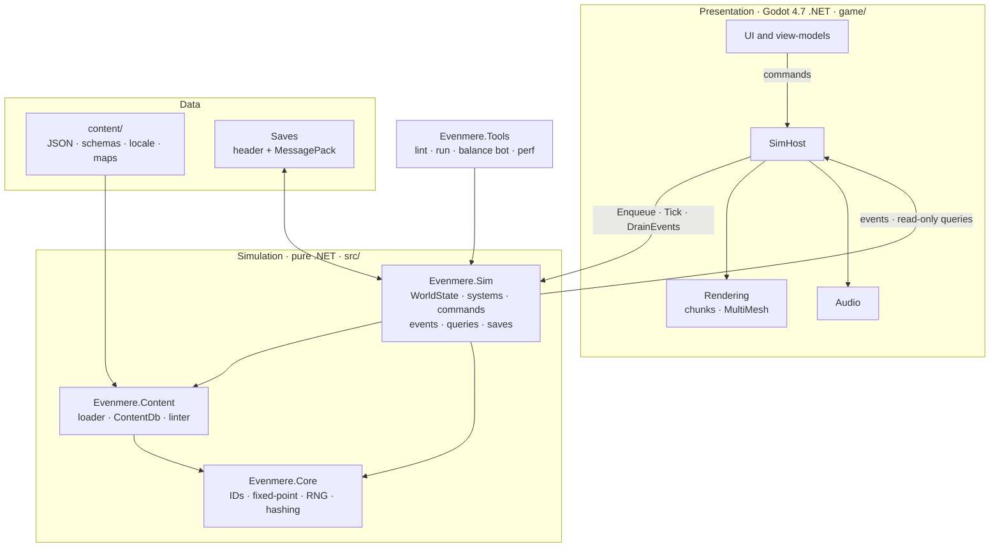
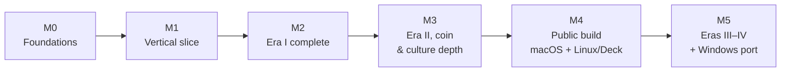

# Evenmere — Architecture Plan

v0.2 · 18 Oct 2026 · Wojtek Powiertowski · **Baseline for implementation.** This supersedes the "Island Civ" draft v0.1.

Companion documents:

- [Progression ladders](progression.md): eras, tiers, needs, goods, production chains, terrain
- [Technology tree](tech-tree.md) and [culture tree](culture-tree.md)
- [Architecture decision records](../adr/README.md)
- [Implementation plan](../implementation/README.md)

## Decisions taken in v0.2

The open questions from v0.1 are resolved as follows.

| Question | Decision |
| --- | --- |
| Platform | **macOS and Linux (including Steam Deck) first**, on Steam; the **Windows port comes last** (M5). See [ADR-0008](../adr/0008-platform-targets.md). |
| Visual style | Stylised low-poly 3D. |
| Language | C# throughout: simulation, tools and the Godot layer. No GDScript. |
| Era span | Four eras: **Founding → Township → Enlightenment → Industry**, ending with steam power, gaslight and early railways. |
| Tone | A grounded, invented world: real-world-style technologies, with invented places, people and faiths. No real nations or religions. |
| Map | One large island. No satellite islets; technology opens new ground on the same island. |
| Coin | **No coin in Era I**, a pure goods economy. The **Coinage** technology (Era II) introduces gentle coin: taxes, visitor spending and upkeep. It is built in milestone M3. See [ADR-0009](../adr/0009-economy-staging.md). |
| Decline | **Always on.** A house steps down one tier after a grace period of unmet basic needs. It never drops below Settlers, never empties, and never cascades. |
| Scale target | 20,000 residents, 5,000 buildings and 2,000 concurrent transport jobs on a Steam Deck–class CPU. |
| Art source | Placeholders for now: low-poly primitives generated from the footprint and a shared palette. A content-ID → scene mapping lets real art drop in later. |
| NPC trade | Deferred beyond v1 (backlog). |

## Changes from v0.1 (review findings)

1. **Renamed** to Evenmere; projects are `Evenmere.*`.
2. **Added `Evenmere.Core`**, a tiny shared-primitives library (IDs, fixed-point, RNG, hashing). Content definitions need `Amount` and typed IDs, but `Evenmere.Content` must not depend on the simulation. Dependencies run Sim → Content → Core.
3. **Fixed a threading hazard.** In v0.1 the `SimHost` ticked on a worker thread while the view read queries, which is a data race. Ticks now run on the main thread inside a fixed-step accumulator, and queries run only between ticks. A worker thread with an immutable frame snapshot is a later optimisation behind the same interface ([ADR-0006](../adr/0006-simhost-threading.md)).
4. **Pinned the time model:** day = 120 ticks, season = 10 days, year = 4 seasons. Daily systems process 1/120 of their entities per tick (bucketed by ID) to avoid frame spikes.
5. **Defined fixed-point types.** `Amount` is a 64-bit count of milli-units, and `Ratio` is a 32-bit per-mille. Modifiers on the same stat **add** before applying once, so they never compound.
6. **Split needs into basic and comfort.** Basic needs drive occupancy, advancement and decline. Comfort needs only boost a tier's output, so luxuries reward and never punish. Market coverage gates access to goods.
7. **Completed the logistics model:** producers have input buffers filled by delivery jobs as well as output buffers emptied by pickup jobs. A building takes part in the island pool only if it is road-connected to a storehouse.
8. **Saves store string-ID tables.** They are remapped on load, so adding content never breaks a save. A content-hash mismatch is reported, never fatal.
9. **`SetSpeed` is a host command,** not a simulation command. Speed never touches state, so replays are speed-independent.
10. **Progression gating.** An era begins only when both its tech gateway and its civic gateway are complete. Tier unlocks alternate between the tech tree (Townsfolk, Scholars) and the culture tree (Artisans, Patrons). Both trees are mandatory, which makes pillar 3 structural ([ADR-0010](../adr/0010-progression-gating.md)).
11. **Rivers are technology-opened ground.** Roads cannot cross rivers until Bridge-building (narrow rivers) and Stone Bridges (wide rivers).
12. **Unlocks have one source of truth.** Techs and civics list what they unlock; buildings don't name their tech. The v0.1 example's `requires.tech` is removed, and the linter enforces exactly one unlock source per item.
13. **Determinism is enforced by tooling, not just policy:** a banned-API analyser, architecture tests, and integer-only map generation (no transcendental `Math` calls, whose results differ across CPUs).
14. **`dotnet build` compiles the Godot layer** through the NuGet `Godot.NET.Sdk`, so agents get compile errors without the editor.
15. **CI is staged.** A local `scripts/verify.sh` exists from M0. GitHub Actions and the mandatory PR flow arrive at the end of M1, once the game is functional.
16. **Gamepad and 1280×800 UI are first-class** from M1, because Steam Deck is a launch target.

## Vision & design pillars

A calm, single-player city builder on one large island: Anno's production chains and population tiers, pushed forward by a Civilization-style technology tree and a parallel culture tree. No military, no rivals, no fail state, and the player sets the pace.

**Core loop:** settle a district → house residents → meet their needs through production chains → residents advance to higher tiers → higher tiers generate knowledge and culture → unlock technologies and civics → new goods, buildings and terrain uses → expand further across the island.

1. **Grow, don't fight.** Challenge comes from space, logistics and balancing needs, never from enemies or deadlines. Pause and speed control are always available.
2. **Knowledge opens the island.** Research unlocks new chains and also new ground: rivers, marshes, hills, highlands and reefs become usable through technology.
3. **Culture is a second path, not a side stat.** A civics tree, festivals, monuments and great works shape how residents live and how the city looks. Two of the six tiers and every era transition need it.
4. **Every number explains itself.** Tooltips trace any shortage to its cause, and problems arrive as gentle advisor notes, not alarms.
5. **A city worth watching.** Visible carts, walkers, smoke, ships and seasons reward zooming in.

**Out of scope for v1:** combat, AI opponents, diplomacy, multiplayer, satellite islets and NPC trader ships (backlog).

## Engine

**Godot 4.7 (.NET edition) with C#, with the simulation in separate engine-free .NET libraries** ([ADR-0001](../adr/0001-engine-and-language.md)). Godot draws the island and the UI. The economy, research and culture live in plain C# that runs and tests without the engine.

- Everything is text: scenes, resources and project settings are diffable, so agents can edit them safely.
- The simulation runs under `dotnet test` in seconds, with no editor and no GPU.
- C# compile errors catch most agent slip-ups before they reach the game.
- The MIT licence means no seats and no royalties.
- **Target framework:** .NET 10 (LTS) for every project, because .NET 8 support ends in November 2026. Task M0-01 verifies that Godot 4.7 builds a `net10.0` game project; if it can't, it falls back to the newest framework Godot supports and records the change in ADR-0001.
- **Renderer:** Forward+, using Metal on macOS and Vulkan on Linux and Steam Deck.

## High-level architecture

Three layers with one-way dependencies: game data, a pure simulation, and a Godot presentation layer that only reads state and sends commands.



Read it bottom-up: content and saves feed the simulation, and Godot draws what the simulation reports. Replacing the engine would mean rewriting the top layer only.

## Simulation core

The simulation is a deterministic, fixed-tick state machine: the same save, seed and commands always produce the same island ([ADR-0003](../adr/0003-deterministic-simulation.md)). That makes bug reports replayable, balance tests reproducible and save files trustworthy.

### Time model

| Unit | Length | At 1× speed |
| --- | --- | --- |
| Tick | 0.25 s game time | 4 ticks per second |
| Day | 120 ticks | 30 s |
| Season | 10 days | 5 min |
| Year | 4 seasons (spring, summer, autumn, winter) | 20 min |

- Speeds are pause, 1×, 2× and 4×; debug builds add 16×. Higher speeds run more ticks per frame, capped by a per-frame tick budget.
- Rendering interpolates between ticks, so animation stays smooth at any speed.
- Seasons change crop yields and visuals but never punish: winter yields dip, and autumn and summer compensate.
- **Cadences:** construction, production and logistics run every tick. Needs, population and the coin economy are **daily but bucketed**: each tick processes the entities whose `id % 120 == tick % 120`. Research and culture accrue once per day. Statistics sample daily and keep rolling one-year windows.

### Determinism rules

- **No floating point in game state or sim logic.** Goods and points use `Amount` (an `int64` count of milli-units, where 1 unit = 1000), and multipliers use `Ratio` (an `int32` per-mille, where 1000 = 100%). Rounding is always toward negative infinity.
- **One seeded PCG32 generator per system,** with its state stored in `WorldState`. `System.Random`, `DateTime.Now`, `Guid.NewGuid`, `Environment.TickCount` and `Parallel` are banned in `Evenmere.Sim` by a Roslyn analyser.
- **Stable ordering.** Entities iterate in ID order. IDs are allocated monotonically and never reused. State never iterates a `Dictionary` or `HashSet`; it uses `IdTable<T>`, sorted arrays or `SortedDictionary`.
- **Integer-only map generation.** The generator uses integer noise and no `Math.Sin`, `Exp` or `Pow`, so a seed produces the same island on every CPU.
- **State hash.** `ComputeStateHash()` hashes a canonical serialisation (XxHash64). Scenario tests and replays compare these hashes.

### State and boundaries

- `WorldState` holds plain data tables keyed by stable IDs: tiles, buildings, roads, houses, workplaces, storage, transport jobs, research, culture, the clock and RNG states. It holds no engine types and no references to presentation objects.
- **Commands in:** the UI sends commands, which queue and apply at the start of the next tick after validation. A rejected command produces a `CommandRejected` event that carries a reason code.
- **Events and queries out:** systems emit events, and the presentation layer reads through read-only queries. The presentation layer never writes state.
- Each system owns its own slice of state. Systems read other systems' state only through that system's query interface.
- The project starts with plain typed tables and system classes, and adopts an ECS library only if profiling demands it.

### Contracts (frozen in M0, changed only via ADR)

```csharp
// Evenmere.Sim — the only surface the game and the tools use.
public interface ISimulation
{
    long CurrentTick { get; }
    void Enqueue(Command command);            // applied at the start of the next tick
    void Tick();                              // advance exactly one tick
    IReadOnlyList<SimEvent> DrainEvents();    // events emitted since the last drain, in emission order
    ISimQueries Query { get; }                // read-only; valid only between ticks
    ulong ComputeStateHash();
}

public abstract record Command;               // e.g. PlaceBuilding, Demolish, SetResearchTarget
public abstract record SimEvent(long Tick);   // e.g. ConstructionCompleted, TierAdvanced, TechResearched
```

### System order (every tick)

| # | System | Cadence | Folder |
| --- | --- | --- | --- |
| 0 | Clock (advance tick, flag day/season boundaries) | tick | `Sim/Clock` |
| 1 | Apply queued commands (dispatch to the owning system's handler) | tick | `Sim/Commands` |
| 2 | Construction: progress sites, consume materials | tick | `Systems/Construction` |
| 3 | Workforce: allocate tier workforce to workplaces | day | `Systems/Workforce` |
| 4 | Production: run recipes, fill buffers | tick | `Systems/Production` |
| 5 | Logistics: assign and advance transport jobs | tick | `Systems/Logistics` |
| 6 | Exploration: advance expeditions, reveal regions | tick | `Systems/Exploration` |
| 7 | Needs: consumption and service coverage | day, bucketed | `Systems/Needs` |
| 8 | Population: occupancy, advance and decline, visitors | day, bucketed | `Systems/Population` |
| 9 | Economy: coin taxes, spending and upkeep (from Era II) | day, bucketed | `Systems/Economy` |
| 10 | Research: knowledge accrual, techs, inspirations | day | `Systems/Research` |
| 11 | Culture: civics, traditions, festivals, great works | day | `Systems/Culture` |
| 12 | Progression: apply unlock effects, check era gateways | day + on demand | `Systems/Progression` |
| 13 | Happenings: gentle choice events | day | `Systems/Happenings` |
| 14 | Advisors: detect problems and explain causes | day | `Systems/Advisors` |
| 15 | Statistics: rolling history for graphs | day | `Systems/Statistics` |

`Map`, `Roads` and `Modifiers` are shared services, not ticked systems. Map and Roads own tiles, the road graph and distance fields; Modifiers owns the effective-stat index, which is rebuilt whenever an effect is added or removed.

## Gameplay systems

Each system is one folder in `Evenmere.Sim` with its own tests. The numbers here and in the progression documents are starting proposals; the balance bot tunes them.

### Island and map

- **Square tile grid, Anno-style:** rectangular footprints, 90° rotation and straightforward road placement.
- **Sizes:** the starter/tutorial island is 128 × 128 tiles and hand-authored; generated islands are 256, 320 (default) or 384 tiles across, in open sea.
- **Seeded generation:** integer height noise with a radial falloff, rivers traced downhill, and biome regions (coast, plains, forest, hills, marsh, highlands). Each crop gets fertility patches, and the generator places mineral deposits, natural wonders, ruins and shipwrecks. The island is partitioned into 40–80 **regions** for fog and exploration.
- **Start guarantee:** the starting region, bounded by rivers, contains everything Era I needs before bridges: forest, coast, grain plains, hills with stone, and clay riverbanks.
- **Technology opens ground:**

  | Ground | Opened by |
  | --- | --- |
  | Narrow rivers (≤ 3 tiles) | Bridge-building |
  | Wide rivers (≤ 8 tiles) | Stone Bridges |
  | Hills for farming | Terracing |
  | Marsh (drained to fen) | Drainage |
  | Highlands | Highland Roads |
  | Deep water | Harbour Works |
  | Reefs | Diving Bell |

### Construction

- Placement checks footprint, terrain, slope, terrain access, road access and unlock state. The view shows the result as a ghost through `IPlacementQueries.Validate`, the same code path the command uses.
- Sites draw materials from the storage pool over time. Builders are abstract (no worker units). A site must be road-connected to a storehouse.
- Buildings upgrade in place: house tiers, Founders' Hall → Town Hall, Market → Market Square, and steam variants in Era IV.
- Demolishing refunds 50% of materials. Demolishing a district triggers an autosave first.
- Monuments and wonders are multi-stage sites. Each stage has its own material bill and a visible state.

### Logistics

**An island-wide storage pool fed by real transport jobs** ([ADR-0005](../adr/0005-logistics-model.md)).

- A producer has a small **output buffer**. When the buffer holds a cart load, it requests a **pickup job** from the nearest storehouse within road reach.
- A producer with inputs has an **input buffer**. When the buffer falls below its threshold, it requests a **delivery job** from the nearest storehouse whose network has the good in the pool.
- Travel time comes from a precomputed **road-distance field per storehouse**, using integer road costs (dirt 1000, cobbled 800, paved 650, rail 300 per tile). A field is rebuilt only when roads inside its reach change.
- Each storehouse has a fixed number of carts. Jobs are assigned deterministically, by request tick and then by building ID.
- Each job is one record in the sim. The cart on screen is a visual replay of that record, and the view pathfinds the cart's route for display only. Sim cost scales with jobs, not with pathfinding agents.
- Goods in any storehouse are available island-wide, as in Anno. To use the pool, a building must be road-connected to at least one storehouse; houses must also be inside a Market's coverage.

### Production chains

- A **recipe** is inputs → outputs, plus a cycle time. The building supplies the workforce requirement (tier × count).
- **Productivity** = workforce fill × input availability × (1000 + Σ bonuses) / 1000. Bonuses come from techs, traditions, fertility, season and area yield.
- **Gatherers** (woodcutter, fishing hut, quarry, mines, farms) scale with their terrain: forest tiles in radius, open water not claimed by another hut, deposit tiles under the footprint, or fertile tiles under a farm's footprint.
- **Stall reasons** are explicit codes (`NoWorkforce`, `MissingInput`, `OutputFull`, `NoStorehouseReach`, `Underfunded`, `Paused`), so every idle building can explain itself.

### Workforce

- Each tier supplies a workforce pool equal to its residents. Every building needs workers of one tier.
- Allocation runs daily. Player-prioritised buildings fill first; everything else gets the same fill ratio, with deterministic remainder distribution by building ID.
- As in Anno, advancing houses removes lower-tier workers, so keeping a balance of tiers is part of the puzzle.

### Population and needs

- Residences belong to one of six tiers: **Settlers → Villagers → Townsfolk → Artisans → Scholars → Patrons** ([progression](progression.md)).
- **Basic needs** are goods (consumed per 1,000 residents per day) and services (a building within road range: Market, Shrine, Tavern, School, Theatre, Concert Hall). Each met basic need raises the house's target occupancy.
  - When all basic needs are met for 3 consecutive days, the house advances, provided the next tier is unlocked, the upgrade materials are in the pool and the player hasn't locked the house.
- **Comfort needs** are goods only. Each met comfort need adds +25% to the tier's knowledge, culture and coin output. A missing comfort good never causes decline.
- **Fair shares.** At each day boundary, the system computes a fulfilment ratio per good from pool stock against projected demand, and every house consumes at that ratio. No house is starved because of its ID.
- **Decline (always on):** if a basic need that the house has had met at its current tier stays below 50% for a full season (10 days), the house steps down one tier. Residents above the lower tier's capacity move out.
  - A need never yet met at this tier only holds occupancy down, so a newly advanced house never bounces straight back.
  - Decline is one step at a time and needs a fresh grace period before it can repeat. It never goes below Settlers and never leaves a house empty.
  - Festivals pause every grace timer while they run.
- **Design rule:** the goods and services a tier needs are made and staffed by lower tiers, so a new tier never deadlocks on its own workforce.
- Each tier supplies its own workforce. From Villagers upward, tiers also generate knowledge, culture or coin, so higher tiers are the engine of progression.

### Research (the Civilization side)

- **Knowledge** comes from tiers (Villagers and up) and from knowledge buildings: Founders' Hall, Scribe's Hall, Library, Observatory, Academy.
- The **tech tree** has 50 techs in four eras ([tech tree](tech-tree.md)). Each tech has a cost, prerequisites and effects (unlocks or modifiers).
- **Inspirations:** reaching a milestone (for example, five fishing huts) cuts a related tech's cost by 40%. An inspiration can trigger before or during research.
- The player picks one research target, with an optional queue. Overflow points carry over.

### Culture

Culture is a parallel progression, not a bonus stat ([culture tree](culture-tree.md)).

- **Culture points** come from cultural buildings, festivals, Artisans, Patrons, monuments and displayed great works.
- The **civics tree** has 31 civics in four eras. Civics unlock **traditions**: cards placed in typed slots (Hearth, Craft, Heritage, Wild) and swappable at any time.
- **Festivals:** a festival ground hosts a festival, which consumes goods for a burst of culture and pauses decline grace timers.
- **Great works:** Storyteller's Circles, Artisans, Scholars and Patrons accumulate creativity and produce named works. The works fill typed display slots and yield culture and attractiveness.
- **Monuments and wonders:** multi-stage builds that change the skyline and grant island-wide effects.
- **Attractiveness:** parks, plazas, gardens, wonders and displayed works raise it; heavy industry lowers it. High attractiveness draws visitors. Before Coinage, visitors become settlers; afterwards, they also spend coin.
- **Architectural style:** each era offers a choice of style tradition in a Heritage slot. The chosen style swaps the city's building variants.

### Exploration

- Fog covers each region not yet revealed. The starting region and the coastline in view start revealed.
- A Scout's Lodge sends **expeditions** to an adjacent fogged region. Each one takes days according to distance and terrain, then reveals the region.
- Discoveries are placed by the generator and revealed by expeditions, so no roll happens at reveal time:
  - **Ruins:** knowledge or a relic great work.
  - **Natural wonders:** culture and attractiveness once an overlook is built.
  - **Shipwrecks:** rare materials.
  - **Deposits.**

### Happenings and advisors

- **Happenings** are gentle, data-driven events with choices and no harsh outcomes: a travelling scholar, a bountiful harvest, a request for a festival. (They are called "happenings" so they don't clash with simulation events.)
- **Advisors** watch for problems, such as a building without road access, a good running short or a house blocked from advancing. Each note explains the cause and links to the fix through the explain queries.

### Coin (from Era II)

- **Era I has no coin.** Buildings cost only materials and have no upkeep.
- The **Coinage** tech (Era II) starts the coin economy:
  - Townsfolk and higher tiers pay taxes scaled by satisfaction.
  - Visitors spend.
  - Buildings that declare `upkeepCoin` (Era II and later) cost upkeep.
  - Later tier upgrades and wonders may cost coin.
- **Gentle by design:** the treasury never goes negative. If upkeep can't be paid, those buildings run at 50% productivity as `Underfunded` and an advisor explains why. There is no debt.

## Data-driven content pipeline

All game content is data, not code: adding a good, building, tech or tradition means editing JSON, never touching a system ([ADR-0004](../adr/0004-data-driven-content.md)).

- **Files:** `content/<type>/<id>.json`, one item per file. The types are `goods`, `buildings`, `recipes`, `tiers`, `techs`, `civics`, `traditions`, `festivals`, `greatworks`, `monuments`, `happenings`, `eras` and `terrains`. Game-wide tunables live in `content/rules/core.json`, and maps in `content/maps/<id>/`.
- **IDs:** `snake_case` strings that are unique within their type.
- **Schemas:** one JSON Schema (draft 2020-12) per type in `content/schemas/`, checked by the linter and usable by editors.
- **Loading:** the sim loads all files into an immutable `ContentDb` at startup. String IDs become compact typed integer IDs (`GoodId`, `BuildingTypeId`, …), assigned in ordinal string order so the mapping is stable. Decimal quantities in JSON (at most three decimal places) become `Amount` exactly.
- **Text:** display names and descriptions live in `content/locale/<lang>/<type>.json`, keyed like `building.bakery.name`. Content files never contain display text.
- **Visuals:** `game/data/visuals/*.json` maps content IDs to Godot scenes, placeholder colours and icons. The sim never knows about meshes.
- **Runtime location:** in development the game reads `content/` from the repo root. Export scripts stage `content/` into the packed build. Content packs (mods) are extra folders with the same layout, loaded after the base game.

### Content shapes (illustrative; the schemas are authoritative)

```json
// content/buildings/bakery.json
{
  "id": "bakery",
  "category": "production",
  "era": 1,
  "footprint": [2, 2],
  "placement": { "terrain": ["plains", "hills"], "roadAccess": true },
  "cost": { "timber": 6 },
  "buildDays": 2,
  "workforce": { "tier": "settlers", "count": 4 },
  "recipe": "bake_bread",
  "tags": ["processing", "food"]
}
```

```json
// content/recipes/bake_bread.json
{ "id": "bake_bread", "inputs": { "flour": 1 }, "outputs": { "bread": 1 }, "cycleSeconds": 30 }
```

```json
// content/techs/milling.json
{
  "id": "milling",
  "era": 1,
  "cost": 60,
  "requires": ["cultivation"],
  "effects": [ { "unlockBuilding": "windmill" }, { "unlockBuilding": "bakery" } ],
  "inspiration": { "when": { "produced": { "good": "grain", "atLeast": 30 } } }
}
```

```json
// content/traditions/harvest_festival.json
{
  "id": "harvest_festival",
  "slot": "craft",
  "effects": [
    { "modifier": { "stat": "productivity", "target": { "tag": "farm" }, "percent": 20, "when": { "season": "autumn" } } }
  ]
}
```

**Effects vocabulary** (shared by techs, civics, traditions, monuments and happenings):

- Unlocks: `unlockBuilding`, `unlockRecipe`, `unlockTier`, `unlockTradition`, `unlockFestival`, `unlockTerrainAccess` (`narrow_rivers`, `wide_rivers`, `hill_farming`, `marsh_drainage`, `highlands`, `deep_water`, `reefs`), `unlockFeature` (`expeditions`, `coin`, `visitors`, `great_works:<type>`)
- `traditionSlot` (`hearth`, `craft`, `heritage`, `wild`)
- `modifier` with a `stat` (`productivity`, `consumption`, `constructionSpeed`, `capacity`, `workforce`, `output.knowledge`, `output.culture`, `output.coin`, `attractiveness`, `visitors`, `cartSpeed`, `materialCost`, `declineGrace`), a `target` selector (`building`, `tag`, `category`, `tier`, `good`, or none for island-wide), an integer `percent`, and an optional `when` condition
- One-off grants: `grantGoods`, `grantPoints`

**Conditions vocabulary** (used by inspirations, happenings, advisors and tutorial steps):

- Counts: `count` (buildings by id, tag or category), `produced` and `consumed` (cumulative goods), `population` (by tier or total), `roadTiles`, `expeditions`, `festivalsHeld`, `greatWorks`, `visitorsPerDay`
- Flags: `researched`, `adopted`, `discovered`, `season`, `era`
- Combinators: `all`, `any`, `not`

### Content linter (CLI and CI)

| Code | Rule |
| --- | --- |
| EVL001 | Schema validation |
| EVL002 | Every reference resolves (recipe goods, unlock targets, prerequisites, locale keys) |
| EVL003 | Tech and civic trees are acyclic, and every node is reachable from the roots |
| EVL004 | Every good has at least one producer and one consumer (construction costs count as consumers) |
| EVL005 | Every building, recipe, tier and tradition is unlocked by exactly one source, or marked `"start": true` |
| EVL006 | Every tier's basic needs can be met using only items unlocked by nodes of the same era or earlier |
| EVL007 | Every display string exists in `locale/en` |
| EVL008 | Era gateways exist (one tech and one civic per era transition), and every era's nodes need only that era or earlier |
| EVL009 | Era I buildings declare no `upkeepCoin` (added in M3) |
| EVL010 | A tier's basic goods and services are produced and staffed only by lower tiers (added in M2) |

## Presentation layer

Godot renders a stylised, low-poly 3D island and hosts all UI. It reads simulation state and sends commands, nothing more.

### Rendering

- **Camera:** tilted perspective with smooth zoom from street level to a whole-island view. It pans by keys, edge scrolling, drag and the gamepad stick, and rotates in 90° steps.
- **Terrain:** generated meshes in 32 × 32 tile chunks, a splat shader for biomes, and roads as strip meshes.
- **Water:** one animated shader plane with shoreline foam from a distance field. Rivers are flat animated strips.
- **Buildings and trees:** one `MultiMeshInstance3D` per building type per chunk. A chunk rebuilds only when the sim marks it dirty.
- **Placeholder art:** each building is drawn as box, roof and chimney primitives sized from its footprint and tinted from its palette slot in `game/data/visuals`. Real glTF models replace these per content ID.
- **Life:** carts, walkers, ships and smoke are instanced meshes with simple vertex animation. They are driven by transport jobs and resident counts from the sim.
- **Level of detail:** fewer walkers and simpler meshes as the camera pulls back. At island view, districts read as colour and silhouette.
- **Art pipeline (later):** Blender → glTF, with one shared palette texture to keep draw calls and art scope small.

### Bridging sim and view

- The `SimHost` node owns the `ISimulation`. Each frame it adds `delta × speed` to an accumulator and runs whole ticks until the accumulator is drained or the per-frame tick budget runs out. Interpolation alpha = accumulator / tick length.
- After ticking, it drains events and the dirty-chunk list and publishes them to view controllers through C# events. View controllers apply only what changed, and nothing in the view holds authoritative state.
- Queries are valid only between ticks, on the main thread. The worker-thread mode (M4) publishes an immutable `FrameSnapshot` instead, with the same query interface ([ADR-0006](../adr/0006-simhost-threading.md)).
- The host owns speed and pause (`SetSpeed`), the command log recorder, autosave timing and cheat routing.

### UI

- Godot Control nodes with one shared theme. View-models pull data through sim queries so panels stay thin.
- **Core screens:** HUD, build menu, building inspector, needs and coverage overlays, production-chain viewer, tech tree, civics tree and traditions board, statistics graphs, notification feed, great-works gallery, and save/load.
- Every number in a tooltip explains its sources, through `IExplainQueries` (for example, "Bread −12/day: 3 bakeries short of flour").
- **Input:** mouse and keyboard plus full gamepad navigation. Layouts are verified at 1280 × 800 (Steam Deck) and 2560 × 1600 (MacBook), and UI scale is a setting.

### Audio

- Ambient layers chosen by zoom level and the district under the camera (harbour, fields, market).
- Calm adaptive music that shifts by era and season.

## Persistence, settings and modding

Because all game state lives in plain data tables, a save is simply a serialised `WorldState` plus a header ([ADR-0007](../adr/0007-save-format.md)).

- **Header:** magic `EVMR`, save format version, game version, content hash, map seed, play time, tick, and the **string-ID tables** for every content type.
- **Body:** MessagePack-CSharp with LZ4 compression. A debug flag writes readable JSON instead.
- **On load:** string IDs are remapped to the current `ContentDb`. Missing content is reported, and those entities are replaced with ruins that refund their materials.
- **Versioning:** each save format version has a migration step, and tests load a fixture save from every past version.
- **Command log:** the host records every command with its tick. A save plus its command log reproduces a session exactly, for bug reports and replays.
- **Autosave:** rotating slots on a timer, and before risky actions such as demolishing a district.
- **Settings** are stored apart from saves: graphics, audio, key and pad bindings, UI scale, accessibility.
- **Modding** is designed in and shipped later. Content packs are folders of the same JSON plus assets, loaded in order after the base game, and the base game loads through the same path.

## Repository layout and module boundaries

```text
evenmere/
├── AGENTS.md                  rules every coding agent reads first (CLAUDE.md imports it)
├── Evenmere.sln               all .NET projects, including the Godot game project
├── global.json · Directory.Build.props · Directory.Packages.props · .editorconfig
├── scripts/                   verify.sh, godot-smoke.sh, export scripts
├── docs/
│   ├── design/                this plan, progression, trees, system specs
│   ├── adr/                   one file per architecture decision
│   └── implementation/        milestone plans and task cards
├── content/                   JSON game data, schemas, locale, maps
├── src/
│   ├── Evenmere.Core/         IDs, Amount, Ratio, PCG32, hashing, IdTable
│   ├── Evenmere.Content/      definitions, loader, ContentDb, linter
│   ├── Evenmere.Sim/          WorldState, Systems/<Name>/, commands, events, queries, saves
│   └── Evenmere.Tools/        CLI: lint, run, hash, balance bot, perf, replay, mapgen preview
├── tests/
│   ├── Evenmere.Core.Tests/
│   ├── Evenmere.Content.Tests/
│   ├── Evenmere.Sim.Tests/    unit tests + Scenarios/
│   └── fixtures/              tiny content packs, maps and saves
└── game/                      Godot 4.7 .NET project (Evenmere.Game.csproj)
    ├── host/  scenes/  rendering/  ui/  input/  audio/
    ├── data/visuals/          content-ID → scene, colour and icon mapping
    └── assets/
```

**Boundary rules** (enforced by project references, architecture tests and analysers):

1. `Evenmere.Core` references nothing. `Evenmere.Content` references only Core. `Evenmere.Sim` references Content and Core. None of the three reference Godot or `game/`.
2. The game talks to the sim only through `ISimulation`: `Enqueue(command)`, `Tick()`, `DrainEvents()` and read-only queries.
3. Content reaches code only through `ContentDb`. Systems contain no hard-coded content IDs; behaviour hangs off categories, tags and effects.
4. Each gameplay system lives in its own folder with its own tests, so one agent task touches one folder. Systems talk to each other only through query interfaces.
5. New public interfaces, or changes to frozen contracts, are proposed in an ADR before they are implemented.

## Testing, tooling and conventions for coding agents

Agents work best when they can prove their change works without a human opening the game.

| Layer | What it checks | Runs in |
| --- | --- | --- |
| Unit tests | One system on a tiny fixture world (a 16 × 16 island, two buildings) | `dotnet test`, seconds |
| Scenario tests | A scripted command list run for N ticks; asserts stats and a golden state hash | `dotnet test`, seconds |
| Architecture tests | Assembly references, banned APIs, no float, double or Dictionary in state types | `dotnet test` |
| Content lint | Schemas, references, reachability, producer/consumer coverage, tier-need availability | `evenmere lint`, every commit |
| Balance bot | An auto-player follows a build order for hours of game time; reports time to each tier and era and flags stalls | CLI, nightly from M2 |
| Godot smoke test | Loads the starter island headless, runs 1,000 ticks, checks for errors | `godot --headless`, every commit |
| Performance budget | Tick time on a large reference save stays under budget | CLI, nightly from M2 |

**One command proves a change:** `scripts/verify.sh` runs restore, build (warnings as errors), all tests, the content lint, and the Godot smoke test when Godot is installed. CI from M1 runs the same script.

**Debug tooling:**

- An in-game overlay showing tick time per system, entity counts and a selected-entity inspector.
- Replay: a save plus its command log reproduces any session.
- A cheat console for testers: grant goods, finish research, jump eras.

## Performance budgets

These are targets on a Steam Deck–class CPU (Zen 2, four cores) at the scale target.

| System | Average per tick |
| --- | --- |
| Construction | 0.10 ms |
| Workforce (daily, amortised) | 0.05 ms |
| Production | 0.40 ms |
| Logistics | 0.50 ms |
| Needs + Population + Economy (bucketed) | 0.40 ms |
| Research + Culture + Progression | 0.05 ms |
| Happenings + Advisors + Statistics | 0.15 ms |
| Clock, commands and other | 0.35 ms |
| **Total** | **≤ 2.0 ms average, ≤ 6 ms p99** |

Frame rate targets are 60 fps on Steam Deck at 1280 × 800 on medium settings, and 120 fps on Apple Silicon at the default settings.

## Milestone roadmap

Six phases. The original v0.1 roadmap graphic was not available, so it is reconstructed here. Each gate is checkable by a test, the balance bot or a playtest. Full task cards are in the [implementation plan](../implementation/README.md).



| Phase | Delivers | Gate |
| --- | --- | --- |
| **M0 Foundations** | Solution, Core and Content libraries, sim skeleton, CLI, scenario harness, Godot project with SimHost | `verify.sh` is green; the same seed produces the same hash over 10,000 ticks; the Godot headless smoke test passes |
| **M1 Vertical slice** | Starter island, Settlers → Villagers, 5 chains, construction, logistics with carts, needs, research and civic basics, core UI, save/load; **then GitHub CI and the PR flow** | The balance bot reaches 100 Villagers with no stall; a playtester does the same in ≤ 45 min; CI is required on `main` |
| **M2 Era I complete** | Generated islands, rivers and bridges, fog and expeditions, seasons, all Era I content, traditions, festivals, monuments, era advance, tree UIs, overlays, migrations | On 5 seeds the balance bot reaches Era II in 90–120 min of game time; the 2k-resident reference save is within budget |
| **M3 Era II, coin & culture depth** | Coinage and the coin economy, visitors and attractiveness, great works, drainage and terracing, styles, Townsfolk and Artisans, all Era II content | The balance bot reaches Era III on 5 seeds; M2 saves migrate |
| **M4 Public build** | Worker-thread host, scale performance, tutorial, settings and accessibility, gamepad and Deck, audio, localisation, macOS and Linux exports, Steam | Performance budget at the scale target; Deck checklist; playtest sign-off; notarised macOS build |
| **M5 Eras III–IV + Windows** | Highlands, harbour, reefs, steam, railways, gaslight, Scholars and Patrons, Era III–IV content, Windows export | The full trees complete in 18–20 h for the balance bot; the Windows build passes smoke and QA |

Era I and Era II content is the minimum for the public build; eras III and IV follow in updates.

## Remaining open items

- [ ] **Visual day/night cycle:** a 30 s game day is too fast to show day and night. Proposal: a presentation-only cycle of one visual day per season. To be decided in M4.
- [ ] **Audio sourcing:** placeholder and CC0 for now; a composer later?
- [ ] **Art direction:** decided after the vertical slice. Options are own Blender art, asset packs or commissioned work.
- [ ] **Name check:** Steam store and trademark availability for "Evenmere".
- [ ] **Localisation languages** beyond English for the public build.
- [ ] **NPC trader ships:** backlog candidate after v1.
