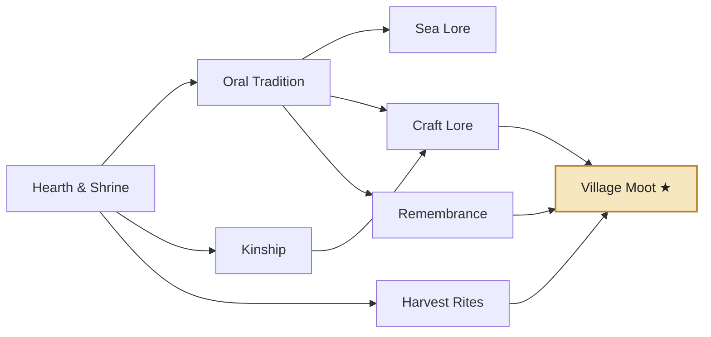
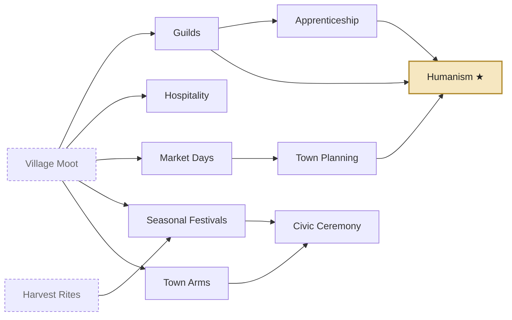
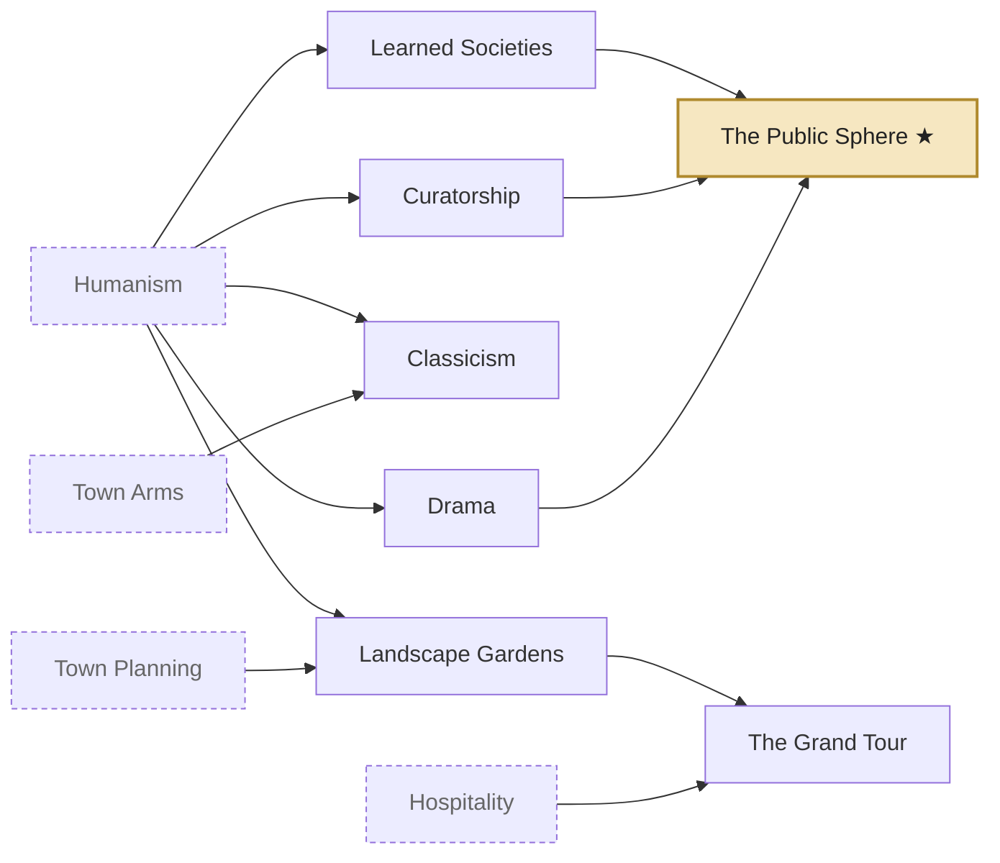
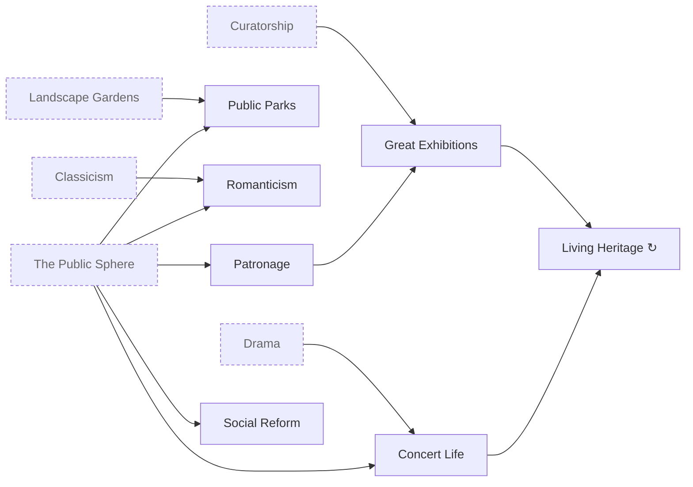

# Evenmere — Culture Tree

v0.2 · 18 Oct 2026 · Companion to the [progression ladders](progression.md) and the [technology tree](tech-tree.md).

Culture is a second path, not a side stat. The civics tree holds 31 civics across four eras. It unlocks two of the six population tiers, every era transition, tradition cards, festivals, great works, monuments and architectural styles. Each civic becomes `content/civics/<id>.json`, and each tradition `content/traditions/<id>.json`. Costs are in culture points and are starting proposals.

## How culture works

- **Culture points** accrue once per day from cultural buildings, Artisans, Patrons, displayed great works, monuments, wonders and running festivals. See [culture sources](progression.md#knowledge-and-culture-sources).
- **Civics** work like techs: one target plus a queue, overflow carries over, and each civic has an **inspiration** that cuts 40% of its cost.
- **Era gating:** a civic of era N needs era N to have begun. Era N+1 begins when the civic gateway ★ **and** the tech gateway of era N are both complete ([ADR-0010](../adr/0010-progression-gating.md)).
- **Traditions** are cards that civics unlock. They are placed in typed **slots**, and swapping is free and allowed at any time; each slot holds one card.
  - **Hearth** cards cover people and needs.
  - **Craft** cards cover production, logistics and construction.
  - **Heritage** cards cover culture, attractiveness and architectural style.
  - **Wild** cards are powerful and fit only Wild slots. A Wild slot also accepts any other card.
- **Tiers:** Artisans come from **Guilds** (Era II) and Patrons from **Patronage** (Era IV).

| Era | Civics | Cost range | Total | Gateway into the next era | Slots by the end of the era |
| --- | --- | --- | --- | --- | --- |
| I Founding | 8 | 20–140 | 500 | Village Moot ★ | 3 (Hearth, Craft, Heritage) |
| II Township | 9 | 700–2,000 | 9,300 | Humanism ★ | 6 (+Craft, +Heritage, +Wild) |
| III Enlightenment | 7 | 2,800–5,500 | 24,900 | The Public Sphere ★ | 8 (+Wild, +Hearth) |
| IV Industry | 7 | 6,000–10,000 | 52,500 + repeats | — | 10 (+Wild, +Heritage) |

## Era I — Founding

| Civic | id | Cost | Requires | Unlocks | Inspiration (−40%) |
| --- | --- | --- | --- | --- | --- |
| Hearth & Shrine | `hearth_and_shrine` | 20 | — | Shrine; **Hearth slot**; *Common Hearth* | Build 5 houses |
| Oral Tradition | `oral_tradition` | 40 | Hearth & Shrine | Storyteller's Circle; Folk Epics (great works); *Fireside Tales* | Have 3 Shrines |
| Kinship | `kinship` | 40 | Hearth & Shrine | **Craft slot**; *Many Hands* | Have 60 Settlers |
| Harvest Rites | `harvest_rites` | 60 | Hearth & Shrine | Festival Ground; Harvest Fair; *Harvest Festival* | Harvest 50 grain |
| Sea Lore | `sea_lore` | 50 | Oral Tradition | *Tide Blessing* | Have 4 Fishing Huts |
| Craft Lore | `craft_lore` | 70 | Kinship, Oral Tradition | *Village Crafts* | Produce 40 homespun |
| Remembrance | `remembrance` | 80 | Oral Tradition | **Heritage slot**; Standing Stones (monument); *Old Ways* | Create a Folk Epic |
| **Village Moot ★** | `village_moot` | 140 | Craft Lore, Harvest Rites, Remembrance | *Common Voice*; civic gateway to Era II | Hold 2 festivals |

## Era II — Township

| Civic | id | Cost | Requires | Unlocks | Inspiration (−40%) |
| --- | --- | --- | --- | --- | --- |
| Guilds | `guilds` | 900 | Village Moot | **Artisans tier**; Guildhall; **Craft slot**; *Guild Standards* | Have 100 Townsfolk |
| Hospitality | `hospitality` | 700 | Village Moot | Inn; Overlook; **visitors**; *Open Doors* | Build 2 Taverns |
| Market Days | `market_days` | 700 | Village Moot | Market Square (upgrade); *Thrift* | Have 4 Markets |
| Seasonal Festivals | `seasonal_festivals` | 850 | Village Moot, Harvest Rites | Midsummer Fair; Winter Lights; *Festival Calendar* | Hold 3 festivals |
| Town Arms | `town_arms` | 900 | Village Moot | **Heritage slot**; styles *Timber-frame Vernacular* and *Island Stone* | Have 3 Plazas |
| Town Planning | `town_planning` | 1,000 | Market Days | Park; Fountain; *Ordered Streets* | Lay 60 cobbled road tiles |
| Civic Ceremony | `civic_ceremony` | 1,100 | Town Arms, Seasonal Festivals | Belfry (monument); *Bell & Chime* | Build the Town Hall |
| Apprenticeship | `apprenticeship` | 1,150 | Guilds | Tapestries and Paintings (Artisans create great works); *Apprentices* | Have 50 Artisans |
| **Humanism ★** | `humanism` | 2,000 | Guilds, Town Planning, Apprenticeship | **Wild slot**; *Humanist Ideals*; civic gateway to Era III | Display 3 great works |

## Era III — Enlightenment

| Civic | id | Cost | Requires | Unlocks | Inspiration (−40%) |
| --- | --- | --- | --- | --- | --- |
| Drama | `drama` | 2,800 | Humanism | Theatre; *Repertory* | Have 200 Artisans |
| Curatorship | `curatorship` | 3,200 | Humanism | Museum; Great Library (wonder); Relic display; *Grand Collections* | Display 6 great works |
| Learned Societies | `learned_societies` | 3,400 | Humanism | **Wild slot**; Treatises and Star Charts (Scholars create great works); Star Tower (wonder); *Correspondence* | Have 4 Libraries |
| Landscape Gardens | `landscape_gardens` | 3,000 | Humanism, Town Planning | Gardens; Botanical Garden (wonder); *Picturesque* | Have 6 Parks |
| The Grand Tour | `grand_tour` | 3,600 | Hospitality, Landscape Gardens | Promenade; Regatta; visitors +50%; *Seaside Promenades* | Host 200 visitors in one day |
| Classicism | `classicism` | 3,400 | Humanism, Town Arms | Styles *Classical Revival* and *Gothic Revival* | Complete a wonder |
| **The Public Sphere ★** | `public_sphere` | 5,500 | Drama, Curatorship, Learned Societies | **Hearth slot**; *Coffeehouse Debates*; civic gateway to Era IV | Have 100 Scholars |

## Era IV — Industry

| Civic | id | Cost | Requires | Unlocks | Inspiration (−40%) |
| --- | --- | --- | --- | --- | --- |
| Patronage | `patronage` | 6,000 | The Public Sphere | **Patrons tier**; **Wild slot**; *Benefactors* | Have 200 Scholars |
| Concert Life | `concert_life` | 6,500 | The Public Sphere, Drama | Concert Hall; Grand Opera (wonder); Symphonies (Patrons create great works); Promenade Concert; *Subscription Concerts* | Have 4 Theatres |
| Public Parks | `public_parks` | 6,500 | The Public Sphere, Landscape Gardens | Public Park; **Heritage slot**; *Green Lungs* | Have 5 steam-upgraded buildings |
| Social Reform | `social_reform` | 7,000 | The Public Sphere | *Reading Rooms*; *Half Holidays* | Have 5,000 residents |
| Romanticism | `romanticism` | 7,500 | The Public Sphere, Classicism | Styles *Romantic Picturesque* and *Industrial Gothic*; natural wonders +50% culture | Discover 3 natural wonders |
| Great Exhibitions | `great_exhibitions` | 9,000 | Patronage, Curatorship | Crystal Pavilion (wonder); Exhibition Fair; *World's Fair* | Display 12 great works |
| Living Heritage ↻ | `living_heritage` | 10,000, +10% per level | Great Exhibitions, Concert Life | +2% culture and attractiveness per level (repeatable) | — |

## Traditions

There are 34 cards. Effects use the shared modifier vocabulary, and percentages on the same stat add up.

### Hearth (people and needs)

| Tradition | id | From | Effect |
| --- | --- | --- | --- |
| Common Hearth | `common_hearth` | Hearth & Shrine | Settler and Villager houses +1 capacity |
| Fireside Tales | `fireside_tales` | Oral Tradition | Villagers +25% knowledge |
| Common Voice | `common_voice` | Village Moot | Decline grace period +50% |
| Thrift | `thrift` | Market Days | Basic goods consumption −10% |
| Apprentices | `apprentices` | Apprenticeship | Artisans supply +15% workforce |
| Coffeehouse Debates | `coffeehouse_debates` | The Public Sphere | Townsfolk and Scholars +10% knowledge |
| Reading Rooms | `reading_rooms` | Social Reform | +10% knowledge from all tiers |
| Half Holidays | `half_holidays` | Social Reform | Comfort-need bonus +50% (each met comfort good gives +37.5% instead of +25%) |

### Craft (production, logistics and construction)

| Tradition | id | From | Effect |
| --- | --- | --- | --- |
| Many Hands | `many_hands` | Kinship | Construction +25% speed |
| Harvest Festival | `harvest_festival` | Harvest Rites | Farms +20% productivity in autumn |
| Tide Blessing | `tide_blessing` | Sea Lore | Fishing +15% productivity |
| Village Crafts | `village_crafts` | Craft Lore | Weaver's Cottages and Potter's Kilns +20% productivity |
| Guild Standards | `guild_standards` | Guilds | Processing buildings +10% productivity |
| Ordered Streets | `ordered_streets` | Town Planning | Carts +15% speed |

### Heritage (culture, attractiveness and style)

| Tradition | id | From | Effect |
| --- | --- | --- | --- |
| Old Ways | `old_ways` | Remembrance | Shrines +1 culture |
| Open Doors | `open_doors` | Hospitality | Visitors +25% |
| Festival Calendar | `festival_calendar` | Seasonal Festivals | Festival goods −25%; festivals last +50% |
| Repertory | `repertory` | Drama | Theatres +25% culture |
| Grand Collections | `grand_collections` | Curatorship | Great works +25% culture |
| Picturesque | `picturesque` | Landscape Gardens | Parks and gardens +50% attractiveness |
| Seaside Promenades | `seaside_promenades` | The Grand Tour | Coastal decorations +50% attractiveness |
| Subscription Concerts | `subscription_concerts` | Concert Life | Concert Halls +25% culture |
| Green Lungs | `green_lungs` | Public Parks | Industry attractiveness penalties −50% |
| *Timber-frame Vernacular* | `style_timber_frame` | Town Arms | **Style** · timber construction costs −10% |
| *Island Stone* | `style_island_stone` | Town Arms | **Style** · decorations +10% attractiveness |
| *Classical Revival* | `style_classical_revival` | Classicism | **Style** · monuments and wonders +10% culture |
| *Gothic Revival* | `style_gothic_revival` | Classicism | **Style** · knowledge buildings +10% knowledge |
| *Romantic Picturesque* | `style_romantic` | Romanticism | **Style** · natural wonders +25% attractiveness |
| *Industrial Gothic* | `style_industrial_gothic` | Romanticism | **Style** · steam upgrades +5% productivity |

### Wild (any slot type fits a Wild slot; these cards fit only Wild slots)

| Tradition | id | From | Effect |
| --- | --- | --- | --- |
| Bell & Chime | `bell_and_chime` | Civic Ceremony | All tiers +5% output |
| Humanist Ideals | `humanist_ideals` | Humanism | +5% knowledge and culture |
| Correspondence | `correspondence` | Learned Societies | Scholars +15% knowledge |
| Benefactors | `benefactors` | Patronage | Monuments and wonders −20% materials |
| World's Fair | `worlds_fair` | Great Exhibitions | Visitors +50%; wonders +25% culture |

### Slots

| Slot | Granted by |
| --- | --- |
| Hearth | Hearth & Shrine (I), The Public Sphere (III) |
| Craft | Kinship (I), Guilds (II) |
| Heritage | Remembrance (I), Town Arms (II), Public Parks (IV) |
| Wild | Humanism (II), Learned Societies (III), Patronage (IV) |

## Architectural styles

Style cards carry the `style` tag, and only one can be slotted at a time. The active style picks the mesh variant set for houses and civic buildings; production buildings keep their own look. With no style card slotted, buildings use the plain vernacular of their era. Swapping styles restyles the city gradually, a few buildings per day, so the change is visible.

| Era | Default (no card) | Choice A | Choice B |
| --- | --- | --- | --- |
| I | Settler vernacular | — | — |
| II | Township vernacular | Timber-frame Vernacular | Island Stone |
| III | Township vernacular | Classical Revival | Gothic Revival |
| IV | Township vernacular | Romantic Picturesque | Industrial Gothic |

## Festivals

Festivals are held at a **Festival Ground**. Only one festival runs at a time island-wide. Each festival type can be held once per year, and a new festival can start only after the previous one ends. While a festival runs, every decline grace timer is paused.

| Festival | id | From | Season | Goods | Days | Effect while running |
| --- | --- | --- | --- | --- | --- | --- |
| Harvest Fair | `harvest_fair` | Harvest Rites | any (culture ×1.5 in autumn) | 20 bread, 10 fish | 5 | +5 culture/day · settlers arrive 50% faster |
| Midsummer Fair | `midsummer_fair` | Seasonal Festivals | summer | 20 beer, 15 cheese | 5 | +10 culture/day |
| Winter Lights | `winter_lights` | Seasonal Festivals | winter | 20 candles, 10 wine | 5 | +10 culture/day · winter crop penalty halved |
| Regatta | `regatta` | The Grand Tour | summer | 20 wine, 20 bread | 5 | +12 culture/day · visitors ×2 |
| Promenade Concert | `promenade_concert` | Concert Life | spring or summer | 20 wine, 20 pastries | 5 | +15 culture/day |
| Exhibition Fair | `exhibition_fair` | Great Exhibitions | any | 20 pastries, 10 pocket watches | 7 | +20 culture/day · visitors ×2 |

Happenings may also *request* a festival ("The fishers ask for a Harvest Fair"). Accepting one gives a goods discount, and declining is free.

## Great works

Creators accumulate **creativity**. A work of their type is created when creativity reaches the threshold **and** a free display slot of the matching type exists; otherwise creativity waits at the threshold. The first work of each type needs 100 creativity, and each later one needs 25% more than the last. Names come from deterministic per-type name tables in the locale files, for example *The Ballad of Seven Coves* or *A Chart of the Autumn Sky*.

| Type | Works | Created by | Unlocked by | Displayed in |
| --- | --- | --- | --- | --- |
| Writing | Folk Epics | Storyteller's Circles (1 creativity/day each) | Oral Tradition | Storyteller's Circle (1), Scribe's Hall (1), Library (2), Academy (2), Great Library (6) |
| Art | Tapestries, Paintings | Artisans (5 creativity per 1,000 residents/day) | Apprenticeship | Guildhall (2), Museum (4) |
| Writing / Science | Treatises / Star Charts | Scholars (5 creativity per 1,000 residents/day) | Learned Societies | Writing slots / Observatory (2), Star Tower (4) |
| Music | Symphonies | Patrons (5 creativity per 1,000 residents/day) | Concert Life | Concert Hall (2), Grand Opera (4) |
| Relic | Relics | Ruins revealed by expeditions | (exploration) | Museum (2 Relic slots) |
| Any | — | — | — | Crystal Pavilion (8, any type) |

A displayed work yields culture by the era it was made in (I/II/III/IV: 2/4/6/8 per day) and +1 attractiveness. Works can be moved between slots freely.

## Monuments and wonders

Every monument and wonder is a multi-stage construction site. Each stage has its own material bill and a visible state, and the effects start when the last stage completes. Each can be built once per island. Stage bills are in the [progression ladders](progression.md#buildings).

| Name | Kind | Era | Unlocked by | Island-wide effect |
| --- | --- | --- | --- | --- |
| Standing Stones | monument | I | Remembrance | +4 culture · +5 attractiveness |
| Belfry | monument | II | Civic Ceremony | +8 culture · decline grace +25% |
| Great Lighthouse | wonder | II | Cartography (tech) | Fishing +15% · reveals the coastline · visitors +10% · +10 culture |
| Great Library | wonder | III | Curatorship | 6 Writing slots · +10% knowledge |
| Star Tower | wonder | III | Learned Societies | 4 Science slots · Scholars +15% knowledge |
| Botanical Garden | wonder | III | Landscape Gardens | +20 attractiveness · farms +5% |
| Railway Terminus | monument | IV | Railways (tech) | Rail jobs +25% speed · visitors +25% |
| Grand Opera | wonder | IV | Concert Life | 4 Music slots · +30 culture |
| Crystal Pavilion | wonder | IV | Great Exhibitions | 8 slots of any type · visitors +50% · +40 culture |

## Attractiveness and visitors

- **Island attractiveness** is the sum of:
  - **Positive:** decorations (Plaza +2, Fountain +2, Park +3, Gardens +5, Public Park +8, Promenade +2, Gas Lamp +1), monuments and wonders, displayed great works (+1 each), and natural wonders that have an Overlook.
  - **Negative:** industry (Charcoal Kiln −1, Smelter −2, Coal Mine −3, Steelworks −4, Sugar Refinery −2, each steam upgrade −2).
- **Before Hospitality:** each point raises the settler move-in rate by 1%, up to +50%.
- **With Hospitality:** visitors per day = min(lodging capacity, 2 × attractiveness). Lodging comes from Inns (40) and Harbours (80), plus visitor modifiers.
- **Before Coinage,** every 20 visitors per day add one settler arrival per day. **After Coinage,** each visitor also spends 1 coin per day.
- **Natural wonders:** the generator places 3–6 per island, for example *Whispering Falls*, *Glass Cove*, *Crown Rock*, *the Old Grove*, *Mirror Tarn* and *Seal Skerries*. Each gives +5 culture and +5 attractiveness once an Overlook is built beside it, and Romanticism adds 50% to their culture.

## Authoring notes

- Civic files list every unlock in `effects`, including `traditionSlot` grants and `unlockTier` (lint EVL005).
- Tradition files set `"slot": "hearth" | "craft" | "heritage" | "wild"`. Style cards add `"tags": ["style"]` and a `"style"` key that the view maps to a mesh variant set.
- Festival, great-work and monument definitions live in `content/festivals/`, `content/greatworks/` and `content/monuments/`. Monument stage bills are arrays of cost objects.
- Name tables for great works and natural wonders live in `content/locale/en/names.json`.
