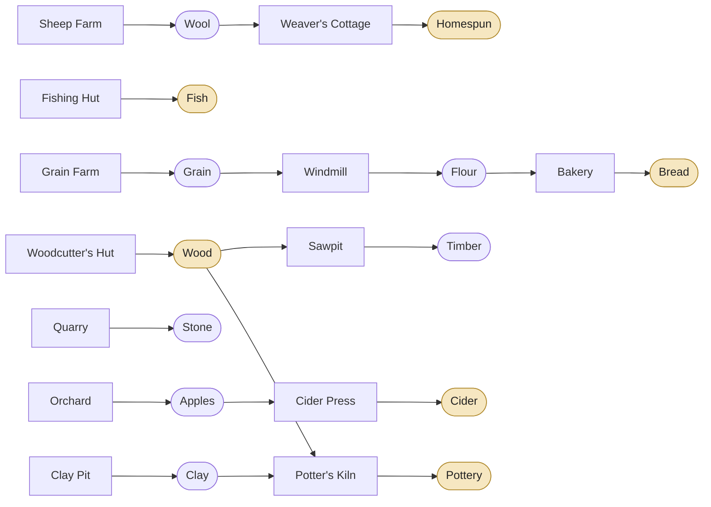
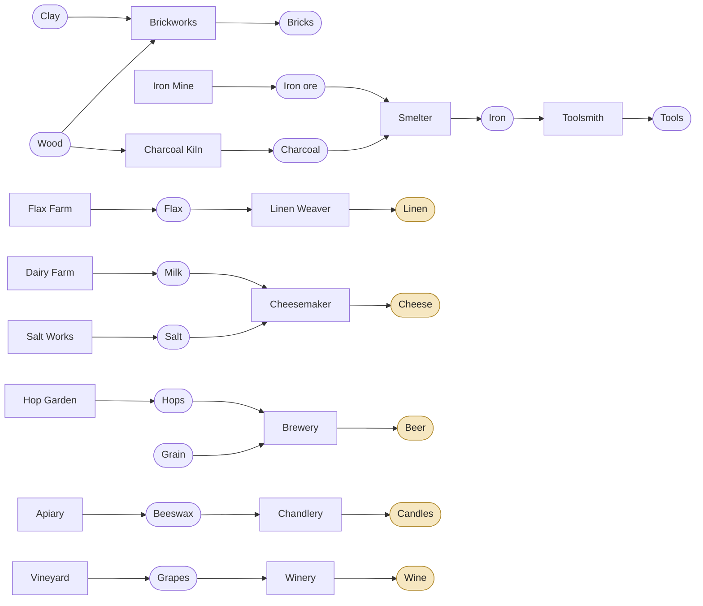
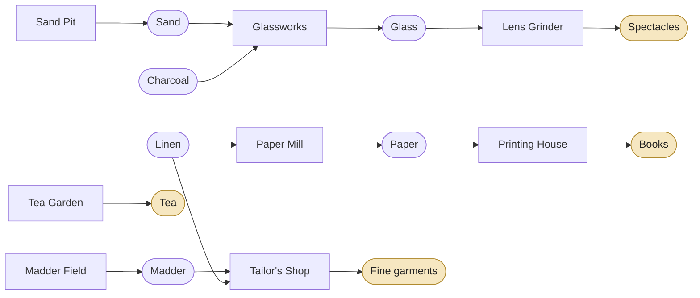
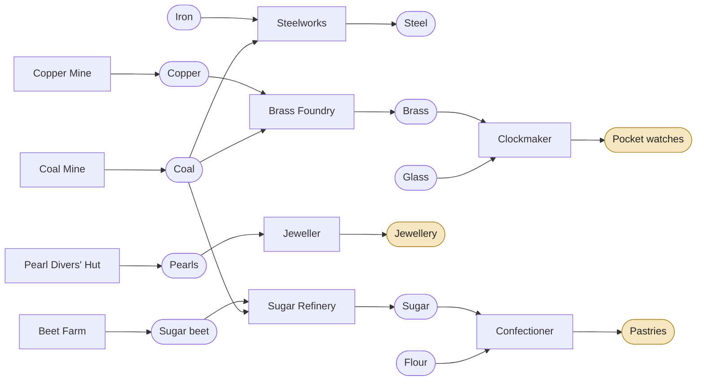

# Evenmere — Progression Ladders

v0.2 · 18 Oct 2026 · Companion to the [architecture plan](architecture.md), the [technology tree](tech-tree.md) and the [culture tree](culture-tree.md).

This document defines the eras, population tiers, needs, goods, production chains, buildings and terrain ladder that both trees unlock. It is the source the content files are written from. **All numbers are starting proposals**; the balance bot tunes them from M2 onward, and the content JSON is authoritative once it exists.

## Eras at a glance

| Era | Name | Begins when | Tiers | New materials | Ground opened | Signature moment |
| --- | --- | --- | --- | --- | --- | --- |
| I | **Founding** | start | Settlers, Villagers | Timber, stone | Narrow rivers | The first harvest festival at the Standing Stones |
| II | **Township** | Town Charter + Village Moot | Townsfolk, Artisans | Bricks, tools | Wide rivers, hills for farming, drained marsh | Coin arrives; the Great Lighthouse lights the coast |
| III | **Enlightenment** | Natural Philosophy + Humanism | Scholars | Glass | Highlands, deep water | The Star Tower and the Great Library open |
| IV | **Industry** | Steam Power + The Public Sphere | Patrons | Steel | Reefs | Rail, gaslight and the Crystal Pavilion |

An era begins only when **both** its tech gateway and its civic gateway are complete ([ADR-0010](../adr/0010-progression-gating.md)).

## Pacing targets

The balance bot measures these at 1× speed. They are the gates for M2, M3 and M5.

| Milestone | Game time | Residents (approx.) |
| --- | --- | --- |
| First Villager house | 10–15 min | 60 |
| 100 Villagers (vertical-slice gate) | ≤ 45 min | 250 |
| Era II begins | 90–120 min | 600 |
| Era III begins | 5–6 h | 3,000 |
| Era IV begins | 10–12 h | 9,000 |
| Both trees complete | 18–20 h | 20,000 |

## Population tiers

Houses are 2 × 2 and upgrade in place. Workers of a tier come only from houses of that tier.

| # | Tier | Era | Unlocked by | Capacity | Upgrade cost | Output per 1,000 residents per day |
| --- | --- | --- | --- | --- | --- | --- |
| 1 | **Settlers** | I | start | 6 | build: 1 timber | (workforce only) |
| 2 | **Villagers** | I | start | 10 | 2 timber | 10 knowledge |
| 3 | **Townsfolk** | II | Town Charter (tech) | 15 | 2 timber, 2 bricks | 15 knowledge · 20 coin¹ |
| 4 | **Artisans** | II | Guilds (civic) | 20 | 2 bricks, 1 tools | 20 culture · 25 coin¹ · 5 creativity |
| 5 | **Scholars** | III | Universities (tech) | 20 | 2 bricks, 1 glass, 20 coin | 40 knowledge · 5 creativity |
| 6 | **Patrons** | IV | Patronage (civic) | 25 | 2 glass, 1 steel, 50 coin | 30 culture · 50 coin · 5 creativity |

¹ Coin flows only after Coinage (Era II).

### Needs

Goods are in **units per 1,000 residents per day**. Services are buildings within road range of the house.

| Tier | Basic goods | Basic services | Comfort goods |
| --- | --- | --- | --- |
| Settlers | Fish 4 · Wood 3 | Market | — |
| Villagers | Fish 3 · Homespun 2 · Bread 4 | Market · Shrine | Cider 2 · Pottery 1.5 |
| Townsfolk | Bread 4 · Cheese 3 · Linen 2 · Pottery 2 | Market · Shrine · Tavern | Beer 2.5 · Candles 1.5 |
| Artisans | Bread 3.5 · Cheese 3 · Linen 2.5 · Candles 2 | Market · Tavern · School | Wine 2 · Beer 2 |
| Scholars | Bread 3 · Cheese 2.5 · Tea 2 · Books 1.5 | Market · School · Theatre | Spectacles 1 · Wine 2 |
| Patrons | Tea 2.5 · Fine garments 1.5 · Pastries 2.5 · Wine 2 | Market · Theatre · Concert Hall | Jewellery 0.75 · Pocket watches 0.75 |

### How needs work

- **Market first.** A house can draw goods only while it is inside a Market's coverage, and that Market must be road-connected to a storehouse.
- **Occupancy.** Target occupancy = max(1, capacity × basic needs met ÷ basic needs total). Residents move one step per day toward the target.
- **Advance.** All basic needs met for 3 consecutive days, plus the next tier unlocked, plus upgrade materials in the pool, plus the house not locked by the player → the house advances and the materials are consumed.
- **Comfort.** Each comfort good that is met adds +25% to the tier's knowledge, culture and coin output from that house. A missing comfort good never hurts.
- **Fair shares.** Each day a fulfilment ratio per good is computed from pool stock against projected demand, and every house consumes at that ratio.
- **Decline (always on).** The decline timer runs while a basic need **that the house has had met at its current tier** is below 50%. After a full season (10 days) the house steps down one tier.
  - A need never yet met at this tier only holds occupancy down, so newly advanced houses never bounce straight back.
  - Decline is one step at a time, never below Settlers, and never to an empty house.
  - Festivals pause every timer while they run.
- **Design rule.** The goods and services a tier needs are produced and staffed by **lower** tiers. A tier's workers are never required to make its own basic needs, which avoids deadlocks when a tier first appears.

## Goods catalogue

There are 47 goods. **Kind:** raw (gathered), intermediate (processed input), construction (building material), need (basic need), comfort (comfort need). Some goods have two kinds.

### Era I — Founding (13)

| Good | id | Kind | Made by | Used by |
| --- | --- | --- | --- | --- |
| Wood | `wood` | raw, need | Woodcutter's Hut | Settlers; Sawpit; Potter's Kiln; Brickworks; Charcoal Kiln |
| Timber | `timber` | construction | Sawpit | Construction |
| Fish | `fish` | need | Fishing Hut; Deep-water Fishery | Settlers, Villagers |
| Wool | `wool` | raw | Sheep Farm | Weaver's Cottage |
| Homespun | `homespun` | need | Weaver's Cottage | Villagers |
| Grain | `grain` | raw | Grain Farm | Windmill, Water Mill; Brewery |
| Flour | `flour` | intermediate | Windmill, Water Mill | Bakery; Confectioner |
| Bread | `bread` | need | Bakery | Villagers, Townsfolk, Artisans, Scholars |
| Stone | `stone` | construction | Quarry | Construction |
| Apples | `apples` | raw | Orchard | Cider Press |
| Cider | `cider` | comfort | Cider Press | Villagers; festivals |
| Clay | `clay` | raw | Clay Pit | Potter's Kiln; Brickworks |
| Pottery | `pottery` | comfort, need | Potter's Kiln | Villagers (comfort); Townsfolk (basic) |

### Era II — Township (16)

| Good | id | Kind | Made by | Used by |
| --- | --- | --- | --- | --- |
| Bricks | `bricks` | construction | Brickworks | Construction |
| Iron ore | `iron_ore` | raw | Iron Mine | Smelter |
| Charcoal | `charcoal` | intermediate | Charcoal Kiln | Smelter; Glassworks |
| Iron | `iron` | intermediate | Smelter | Toolsmith; Steelworks |
| Tools | `tools` | construction | Toolsmith | Construction |
| Flax | `flax` | raw | Flax Farm | Linen Weaver |
| Linen | `linen` | need, intermediate | Linen Weaver | Townsfolk, Artisans; Paper Mill; Tailor's Shop |
| Milk | `milk` | raw | Dairy Farm | Cheesemaker |
| Salt | `salt` | raw | Salt Works | Cheesemaker |
| Cheese | `cheese` | need | Cheesemaker | Townsfolk, Artisans, Scholars |
| Hops | `hops` | raw | Hop Garden | Brewery |
| Beer | `beer` | comfort | Brewery | Townsfolk, Artisans; festivals |
| Beeswax | `beeswax` | raw | Apiary | Chandlery |
| Candles | `candles` | comfort, need | Chandlery | Townsfolk (comfort); Artisans (basic); festivals |
| Grapes | `grapes` | raw | Vineyard | Winery |
| Wine | `wine` | comfort, need | Winery | Artisans, Scholars (comfort); Patrons (basic); festivals |

### Era III — Enlightenment (8)

| Good | id | Kind | Made by | Used by |
| --- | --- | --- | --- | --- |
| Paper | `paper` | intermediate | Paper Mill | Printing House |
| Books | `books` | need | Printing House | Scholars; Great Library stages |
| Sand | `sand` | raw | Sand Pit | Glassworks |
| Glass | `glass` | construction, intermediate | Glassworks | Construction; Lens Grinder; Clockmaker |
| Spectacles | `spectacles` | comfort | Lens Grinder | Scholars; Star Tower stages |
| Tea | `tea` | need | Tea Garden | Scholars, Patrons; Botanical Garden stages |
| Madder | `madder` | raw | Madder Field | Tailor's Shop |
| Fine garments | `fine_garments` | need | Tailor's Shop | Patrons |

### Era IV — Industry (10)

| Good | id | Kind | Made by | Used by |
| --- | --- | --- | --- | --- |
| Coal | `coal` | raw, fuel | Coal Mine | Steelworks; Brass Foundry; Sugar Refinery; steam upgrades; Gasworks |
| Steel | `steel` | construction | Steelworks | Construction |
| Copper | `copper` | raw | Copper Mine | Brass Foundry |
| Brass | `brass` | intermediate | Brass Foundry | Clockmaker |
| Pocket watches | `pocket_watches` | comfort | Clockmaker | Patrons |
| Pearls | `pearls` | raw | Pearl Divers' Hut | Jeweller |
| Jewellery | `jewellery` | comfort | Jeweller | Patrons |
| Sugar beet | `sugar_beet` | raw | Beet Farm | Sugar Refinery |
| Sugar | `sugar` | intermediate | Sugar Refinery | Confectioner |
| Pastries | `pastries` | need | Confectioner | Patrons |

### Construction materials ladder

| Era | Materials | Typical use |
| --- | --- | --- |
| I | Timber, stone | Huts, farms, the first civic buildings |
| II | + Bricks, tools | Workshops, services, Townsfolk and Artisans upgrades |
| III | + Glass | Knowledge and culture buildings, Scholars upgrades, wonders |
| IV | + Steel | Industry, rail, Patrons upgrades, wonders |

## Production chains

The arrows read gatherer → good → processor → good. **Bold** goods are consumed by residents.

### Era I (8 chains)

### Era II (7 chains)

### Era III (5 chains)

### Era IV (4 chains + coal)

## Buildings

**Cycle** is game seconds per unit of output at 100% productivity; one day is 30 s, so a 30 s cycle makes 1 unit per day. **Seasonal** farms follow the season yield curve: spring 100%, summer 120%, autumn 110%, winter 70%. Placement always needs road access unless noted. From Era II onward, buildings declare an upkeep of 1–6 coin per day, which applies only after Coinage; the content files hold the exact values.

### Era I — production

| Building | id | Size | Placement | Workforce | Recipe | Cycle | Cost | Unlocked by |
| --- | --- | --- | --- | --- | --- | --- | --- | --- |
| Woodcutter's Hut | `woodcutters_hut` | 2×2 | land; yield from forest tiles within 4 | 3 Settlers | → Wood | 20 s | 3 timber | start |
| Sawpit | `sawpit` | 2×2 | land | 3 Settlers | Wood → Timber | 20 s | 3 timber | start |
| Fishing Hut | `fishing_hut` | 2×2 | coastline; yield from unclaimed water within 5 | 3 Settlers | → Fish | 20 s | 3 timber | start |
| Sheep Farm | `sheep_farm` | 4×4 | plains | 3 Settlers | → Wool | 30 s | 4 timber | Animal Husbandry |
| Weaver's Cottage | `weavers_cottage` | 2×2 | land | 4 Settlers | Wool → Homespun | 30 s | 4 timber | Weaving |
| Grain Farm | `grain_farm` | 5×5 | plains; grain fertility | 4 Settlers | → Grain | 40 s, seasonal | 4 timber | Cultivation |
| Windmill | `windmill` | 2×2 | land; +15% on hills | 3 Settlers | Grain → Flour | 30 s | 6 timber | Milling |
| Bakery | `bakery` | 2×2 | land | 4 Settlers | Flour → Bread | 30 s | 6 timber | Milling |
| Quarry | `quarry` | 3×3 | hills over a stone outcrop | 5 Settlers | → Stone | 40 s | 6 timber | Stonecutting |
| Clay Pit | `clay_pit` | 3×3 | clay deposit (riverbanks) | 4 Settlers | → Clay | 30 s | 4 timber | Pottery |
| Potter's Kiln | `potters_kiln` | 2×2 | land | 4 Settlers | Clay + Wood → Pottery | 40 s | 4 timber, 4 stone | Pottery |
| Orchard | `orchard` | 4×4 | plains; apple fertility | 3 Settlers | → Apples | 45 s, seasonal | 4 timber | Orcharding |
| Cider Press | `cider_press` | 2×2 | land | 4 Villagers | Apples → Cider | 40 s | 4 timber, 2 stone | Orcharding |

### Era I — infrastructure, services, knowledge and culture

| Building | id | Size | Workforce | Function | Cost | Unlocked by |
| --- | --- | --- | --- | --- | --- | --- |
| Founders' Hall | `founders_hall` | 4×4 | — | Pre-placed and unique. Storehouse (reach 24, 3 carts) · Market coverage 16 · +2 knowledge · +1 culture · starts with 40 timber, 20 fish, 10 wood | start |
| Settler House | `settler_house` | 2×2 | — | Capacity 6; upgrades in place through every tier | 1 timber | start |
| Dirt Road | `dirt_road` | 1×1 | — | Road cost 1000 per tile | free | start |
| Cobbled Road | `cobbled_road` | 1×1 | — | Road cost 800 per tile | 1 stone | Stonecutting |
| Storehouse | `storehouse` | 2×2 | 2 Settlers | Reach 20, 2 carts | 4 timber | start |
| Stone Storehouse | `stone_storehouse` | 2×2 | 2 Settlers | Upgrade of Storehouse: reach 26, 3 carts | 4 stone | Masonry |
| Market | `market` | 3×3 | 2 Settlers | Coverage 16 | 6 timber | start |
| Shrine | `shrine` | 2×2 | 1 Settler | Service coverage 14 · +1 culture | 6 timber | Hearth & Shrine |
| Scout's Lodge | `scouts_lodge` | 2×2 | 2 Settlers | One expedition at a time | 6 timber | Pathfinding |
| Timber Bridge | `timber_bridge` | 1×(2–5) | — | Road across a river up to 3 tiles wide | 2 timber per tile | Bridge-building |
| Scribe's Hall | `scribes_hall` | 3×3 | 4 Villagers | +4 knowledge · 1 Writing slot | 8 timber, 6 stone | Letters |
| Storyteller's Circle | `storytellers_circle` | 3×3 | 2 Villagers | +3 culture · 1 creativity/day (Folk Epics) · 1 Writing slot | 6 timber, 4 stone | Oral Tradition |
| Festival Ground | `festival_ground` | 4×4 | — | Hosts festivals | 8 timber | Harvest Rites |
| Plaza | `plaza` | 2×2 | — | +2 attractiveness | 4 stone | Masonry |
| Standing Stones | `standing_stones` | 3×3 | — | Monument in 3 stages · +4 culture · +5 attractiveness | 20 stone / 30 stone + 10 timber / 40 stone | Remembrance |

### Era II — production

| Building | id | Size | Placement | Workforce | Recipe | Cycle | Cost | Unlocked by |
| --- | --- | --- | --- | --- | --- | --- | --- | --- |
| Brickworks | `brickworks` | 3×3 | land | 6 Villagers | Clay + Wood → Bricks | 40 s | 6 timber, 6 stone | Brickmaking |
| Iron Mine | `iron_mine` | 3×3 | hills over an iron deposit | 6 Villagers | → Iron ore | 45 s | 8 timber, 4 stone | Mining |
| Charcoal Kiln | `charcoal_kiln` | 2×2 | land | 3 Settlers | Wood → Charcoal | 30 s | 4 timber, 4 stone | Ironworking |
| Smelter | `smelter` | 3×3 | land | 6 Townsfolk | Iron ore + Charcoal → Iron | 45 s | 8 stone, 6 bricks | Ironworking |
| Toolsmith | `toolsmith` | 2×2 | land | 4 Townsfolk | Iron → Tools | 40 s | 4 timber, 6 bricks | Ironworking |
| Flax Farm | `flax_farm` | 5×5 | plains or fen; flax fertility | 4 Villagers | → Flax | 40 s, seasonal | 4 timber | Linen-making |
| Linen Weaver | `linen_weaver` | 2×2 | land | 4 Villagers | Flax → Linen | 40 s | 4 timber, 4 bricks | Linen-making |
| Dairy Farm | `dairy_farm` | 4×4 | plains | 4 Villagers | → Milk | 30 s | 6 timber | Dairying |
| Salt Works | `salt_works` | 3×3 | coast flats | 4 Settlers | → Salt | 40 s | 4 timber, 4 stone | Dairying |
| Cheesemaker | `cheesemaker` | 2×2 | land | 4 Villagers | Milk + Salt → Cheese | 40 s | 4 timber, 4 bricks | Dairying |
| Hop Garden | `hop_garden` | 4×4 | plains; hop fertility | 3 Villagers | → Hops | 45 s, seasonal | 4 timber | Brewing |
| Brewery | `brewery` | 3×3 | land | 5 Townsfolk | Grain + Hops → Beer | 45 s | 6 timber, 6 bricks | Brewing |
| Apiary | `apiary` | 3×3 | plains; +20% beside orchards | 2 Villagers | → Beeswax | 40 s | 4 timber | Beekeeping |
| Chandlery | `chandlery` | 2×2 | land | 4 Townsfolk | Beeswax → Candles | 40 s | 4 timber, 4 bricks | Beekeeping |
| Vineyard | `vineyard` | 4×4 | hills (terraced); grape fertility | 4 Villagers | → Grapes | 50 s, seasonal | 6 timber, 4 stone | Viticulture |
| Winery | `winery` | 3×3 | land | 5 Townsfolk | Grapes → Wine | 50 s | 6 bricks, 2 tools | Viticulture |

### Era II — infrastructure, services, knowledge and culture

| Building | id | Size | Workforce | Function | Cost | Unlocked by |
| --- | --- | --- | --- | --- | --- | --- |
| Town Hall | `town_hall` | 4×4 | — | Upgrade of Founders' Hall: reach 28, 4 carts · coverage 20 · +6 knowledge · +2 culture | 10 timber, 10 bricks | Town Charter |
| Counting House | `counting_house` | 3×3 | 4 Townsfolk | Needed to collect taxes · +10% coin | 8 bricks, 2 tools | Coinage |
| Tavern | `tavern` | 2×2 | 3 Villagers | Service coverage 16 · +1 culture | 6 timber, 4 bricks | Brewing |
| School | `school` | 3×3 | 4 Townsfolk | Service coverage 18 | 8 bricks, 2 tools | Schooling |
| Library | `library` | 3×3 | 6 Townsfolk | +10 knowledge · 2 Writing slots | 4 timber, 10 bricks, 2 tools | Schooling |
| Stone Bridge | `stone_bridge` | 1×(2–10) | — | Road across a river up to 8 tiles wide | 4 stone + 1 bricks per tile | Stone Bridges |
| Drainage Ditch | `drainage_ditch` | area tool | — | Converts marsh tiles to fen (fertile, buildable) | 1 stone per tile | Drainage |
| Terraced fields | — | rule | — | Farms may be placed on hills | — | Terracing |
| Guildhall | `guildhall` | 3×3 | 6 Townsfolk | +6 culture · 2 Art slots | 10 bricks, 4 tools | Guilds |
| Inn | `inn` | 3×3 | 4 Townsfolk | Lodges 40 visitors per day | 8 timber, 6 bricks | Hospitality |
| Overlook | `overlook` | 2×2 | — | Next to a natural wonder: its culture and attractiveness count | 4 stone | Hospitality |
| Market Square | `market_square` | 3×3 | 2 Settlers | Upgrade of Market: coverage 22 · +2 attractiveness | 6 bricks, 4 stone | Market Days |
| Park | `park` | 2×2 | — | +3 attractiveness | 2 timber | Town Planning |
| Fountain | `fountain` | 1×1 | — | +2 attractiveness | 2 stone | Town Planning |
| Belfry | `belfry` | 3×3 | — | Monument in 3 stages · +8 culture · decline grace +25% | 30 stone / 20 bricks + 10 timber / 20 bricks + 6 tools | Civic Ceremony |
| Great Lighthouse | `great_lighthouse` | 3×3 coastal | — | Wonder in 4 stages · fishing +15% · reveals coastline fog · visitors +10% · +10 culture | 40 stone / 30 bricks / 20 bricks + 10 tools / 20 tools + 20 timber | Cartography |

### Era III — production

| Building | id | Size | Placement | Workforce | Recipe | Cycle | Cost | Unlocked by |
| --- | --- | --- | --- | --- | --- | --- | --- | --- |
| Paper Mill | `paper_mill` | 3×3 | beside a river | 6 Artisans | Linen → Paper | 45 s | 8 bricks, 4 tools | Papermaking |
| Printing House | `printing_house` | 3×3 | land | 6 Artisans | Paper → Books | 50 s | 8 bricks, 4 tools, 2 glass | Printing Press |
| Sand Pit | `sand_pit` | 3×3 | beach | 4 Villagers | → Sand | 30 s | 4 timber | Glassblowing |
| Glassworks | `glassworks` | 3×3 | land | 6 Townsfolk | Sand + Charcoal → Glass | 50 s | 8 bricks, 4 tools | Glassblowing |
| Lens Grinder | `lens_grinder` | 2×2 | land | 4 Scholars | Glass → Spectacles | 60 s | 6 bricks, 2 tools | Optics |
| Tea Garden | `tea_garden` | 4×4 | highlands or terraced hills; tea fertility | 4 Townsfolk | → Tea | 50 s, seasonal | 6 timber, 4 stone | Tea Cultivation |
| Madder Field | `madder_field` | 4×4 | fen | 4 Villagers | → Madder | 45 s, seasonal | 4 timber | Dyeing & Tailoring |
| Tailor's Shop | `tailors_shop` | 2×2 | land | 5 Artisans | Linen + Madder → Fine garments | 50 s | 6 bricks, 2 tools, 1 glass | Dyeing & Tailoring |
| Water Mill | `water_mill` | 2×2 | beside a river | 3 Settlers | Grain → Flour | 20 s | 6 timber, 4 stone, 2 tools | Mechanics |
| Deep-water Fishery | `deep_water_fishery` | 3×3 | coast with deep water | 4 Villagers | → Fish | 15 s | 8 timber, 2 tools | Harbour Works |

### Era III — infrastructure, services, knowledge and culture

| Building | id | Size | Workforce | Function | Cost | Unlocked by |
| --- | --- | --- | --- | --- | --- | --- |
| Observatory | `observatory` | 3×3 | 4 Scholars | +20 knowledge (+25% on hills or highlands) · 2 Science slots | 8 stone, 6 bricks, 4 glass | Optics |
| Academy | `academy` | 4×4 | 8 Scholars | +30 knowledge · 2 Writing slots | 12 bricks, 6 glass, 4 tools | Universities |
| Bathhouse | `bathhouse` | 3×3 | 4 Townsfolk | Houses in range +10% capacity · +3 attractiveness | 10 bricks, 4 tools | Sanitation |
| Harbour | `harbour` | 4×6 coastal | 6 Townsfolk | Storehouse (reach 24, 4 carts) · lodges 80 visitors per day · visitor ships | 12 timber, 10 bricks, 6 tools | Harbour Works |
| Theatre | `theatre` | 3×3 | 4 Artisans | Service coverage 20 · +8 culture | 12 bricks, 4 glass | Drama |
| Museum | `museum` | 4×4 | 4 Artisans | +4 culture · 4 Art + 2 Relic slots | 14 bricks, 6 glass | Curatorship |
| Gardens | `gardens` | 3×3 | — | +5 attractiveness | 4 stone, 2 glass | Landscape Gardens |
| Promenade | `promenade` | 1×1 coastal | — | +2 attractiveness | 2 stone | The Grand Tour |
| Great Library | `great_library` | 5×5 | — | Wonder in 4 stages · 6 Writing slots · +10% knowledge | 30 bricks / 20 glass / 40 books / 20 bricks + 10 glass | Curatorship |
| Star Tower | `star_tower` | 3×3 hills or highlands | — | Wonder in 4 stages · 4 Science slots · Scholars +15% knowledge | 40 stone / 20 glass / 20 spectacles / 20 bricks + 10 glass | Learned Societies |
| Botanical Garden | `botanical_garden` | 5×5 | — | Wonder in 3 stages · +20 attractiveness · farms +5% | 30 bricks / 30 glass / 30 tea | Landscape Gardens |

The Great Library's books stage needs the Printing Press, and the Star Tower's spectacles stage needs Optics. Each wonder still has a single unlock source.

### Era IV — production

| Building | id | Size | Placement | Workforce | Recipe | Cycle | Cost | Unlocked by |
| --- | --- | --- | --- | --- | --- | --- | --- | --- |
| Coal Mine | `coal_mine` | 3×3 | highlands over a coal seam | 8 Townsfolk | → Coal | 40 s | 10 bricks, 4 tools | Coal Mining |
| Steelworks | `steelworks` | 4×4 | land | 10 Townsfolk | Iron + Coal → Steel | 60 s | 16 bricks, 6 tools | Steelmaking |
| Copper Mine | `copper_mine` | 3×3 | highlands over a copper deposit | 6 Townsfolk | → Copper | 45 s | 10 bricks, 4 tools | Brassworking |
| Brass Foundry | `brass_foundry` | 3×3 | land | 6 Artisans | Copper + Coal → Brass | 50 s | 12 bricks, 4 tools | Brassworking |
| Clockmaker | `clockmaker` | 2×2 | land | 4 Scholars | Brass + Glass → Pocket watches | 90 s | 8 bricks, 4 glass, 2 steel | Precision Clockwork |
| Pearl Divers' Hut | `pearl_divers_hut` | 2×2 | coast beside a reef | 3 Villagers | → Pearls | 60 s | 8 timber, 2 tools | Diving Bell |
| Jeweller | `jeweller` | 2×2 | land | 4 Artisans | Pearls → Jewellery | 60 s | 8 bricks, 2 glass | Diving Bell |
| Beet Farm | `beet_farm` | 5×5 | fen | 4 Villagers | → Sugar beet | 45 s, seasonal | 6 timber | Sugar Refining |
| Sugar Refinery | `sugar_refinery` | 3×3 | land | 6 Townsfolk | Sugar beet + Coal → Sugar | 50 s | 12 bricks, 4 steel | Sugar Refining |
| Confectioner | `confectioner` | 2×2 | land | 4 Artisans | Flour + Sugar → Pastries | 45 s | 8 bricks, 2 glass | Sugar Refining |

### Era IV — infrastructure, services, knowledge and culture

| Building | id | Size | Workforce | Function | Cost | Unlocked by |
| --- | --- | --- | --- | --- | --- | --- |
| Steam upgrades | `steam_*` | — | — | Upgrade variants of Sawpit, Windmill, Water Mill, Brickworks, Linen Weaver, Glassworks and Brewery · +50% productivity · fuel 0.5 coal per day · −2 attractiveness | 4 steel, 4 bricks | Steam Mills |
| Rail Track | `rail_track` | 1×1 | — | Road cost 300 per tile | 1 steel | Railways |
| Railway Station | `railway_station` | 3×4 | 4 Townsfolk | Storehouse (reach 30 along rail, 6 carts) | 16 bricks, 8 steel | Railways |
| Gasworks | `gasworks` | 3×3 | 4 Townsfolk | Fuel 1 coal per day · gas coverage 24 | 12 bricks, 4 steel | Gas Lighting |
| Gas Lamp | `gas_lamp` | 1×1 | — | +1 attractiveness inside gas coverage · lit at night | 1 steel, 1 glass | Gas Lighting |
| Concert Hall | `concert_hall` | 4×4 | 4 Scholars | Service coverage 22 · +12 culture · 2 Music slots | 16 bricks, 6 glass, 4 steel | Concert Life |
| Public Park | `public_park` | 4×4 | — | +8 attractiveness | 4 stone, 2 steel | Public Parks |
| Railway Terminus | `railway_terminus` | 4×6 | — | Monument in 3 stages · rail jobs +25% speed · visitors +25% | 30 bricks / 20 steel / 20 glass + 10 steel | Railways |
| Grand Opera | `grand_opera` | 5×5 | — | Wonder in 4 stages · 4 Music slots · +30 culture | 40 bricks / 20 steel / 20 glass / 20 wine + 20 candles | Concert Life |
| Crystal Pavilion | `crystal_pavilion` | 6×6 | — | Wonder in 4 stages · 8 slots of any type · visitors +50% · +40 culture | 40 glass / 30 steel / 40 glass / 30 steel + 20 tools | Great Exhibitions |

## Knowledge and culture sources

| Source | Knowledge per day | Culture per day |
| --- | --- | --- |
| Founders' Hall → Town Hall | 2 → 6 | 1 → 2 |
| Villagers / Townsfolk / Scholars (per 1,000) | 10 / 15 / 40 | — |
| Artisans / Patrons (per 1,000) | — | 20 / 30 |
| Scribe's Hall · Library · Observatory · Academy | 4 · 10 · 20 · 30 | — |
| Shrine · Tavern · Storyteller's Circle · Guildhall · Theatre · Museum · Concert Hall | — | 1 · 1 · 3 · 6 · 8 · 4 · 12 |
| Displayed great work (by era of creation I/II/III/IV) | — | 2 / 4 / 6 / 8 |
| Monuments and wonders | some | 4–40 |
| Festivals (while running) | — | 5–15 |

Comfort needs add +25% to tier output per comfort good met. Tech and civic costs are in the [technology tree](tech-tree.md) and the [culture tree](culture-tree.md).

## Terrain and access ladder

| Terrain | At start | Opened by | Main uses |
| --- | --- | --- | --- |
| Plains | buildable | — | Houses, farms, most buildings |
| Forest | buildable (clearing trees) | — | Woodcutters (forest is renewable, never depleted) |
| Coast / beach | buildable | — | Fishing huts; Salt Works (II); Sand Pit (III); Harbour (III) |
| River | blocks roads | Bridge-building (≤ 3 wide), Stone Bridges (≤ 8 wide) | Clay pits on banks; Water Mill and Paper Mill beside rivers |
| Hills | buildable, no farms | Terracing (farms and vineyards) | Quarries; Iron Mines (II); windmill bonus; Observatory bonus |
| Marsh | unbuildable | Drainage → fen | Fen: flax, madder (III), sugar beet (IV) |
| Highlands | unreachable | Highland Roads | Tea (III); coal and copper (IV); Star Tower |
| Deep water | — | Harbour Works | Deep-water Fishery; Harbour |
| Reef | — | Diving Bell | Pearl Divers' Hut |
| Peaks | never | — | Scenery; natural wonders |

**Fertility layers** (generated per crop): grain, flax, hops, apples, grapes, tea, madder and sugar beet. A farm's yield is the share of its footprint tiles that are fertile for its crop. It can't be placed below 25%.

**Deposits:** stone outcrops (hills), clay (riverbanks), iron (hills), coal and copper (highlands), and reefs (offshore).

## Lint cross-check (EVL006)

Each tier's basic needs come only from nodes of the tier's era or earlier.

| Tier (era) | Need → unlock source (era) |
| --- | --- |
| Settlers (I) | Fish, Wood, Market → start |
| Villagers (I) | Homespun → Weaving (I); Bread → Milling (I); Shrine → Hearth & Shrine (I) |
| Townsfolk (II) | Cheese → Dairying (II); Linen → Linen-making (II); Pottery → Pottery (I); Tavern → Brewing (II) |
| Artisans (II) | Candles → Beekeeping (II); School → Schooling (II) |
| Scholars (III) | Tea → Tea Cultivation (III); Books → Printing Press (III); Theatre → Drama (III) |
| Patrons (IV) | Fine garments → Dyeing & Tailoring (III); Pastries → Sugar Refining (IV); Wine → Viticulture (II); Concert Hall → Concert Life (IV) |
