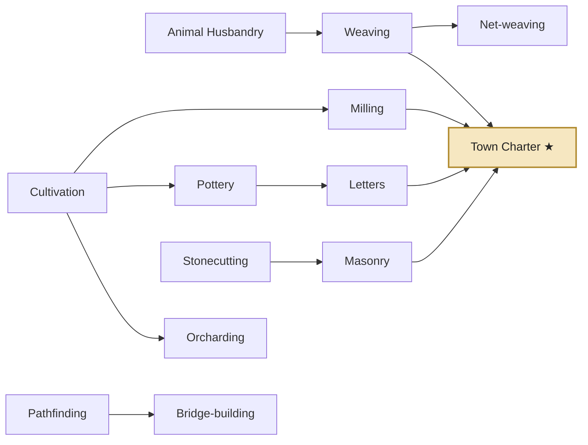
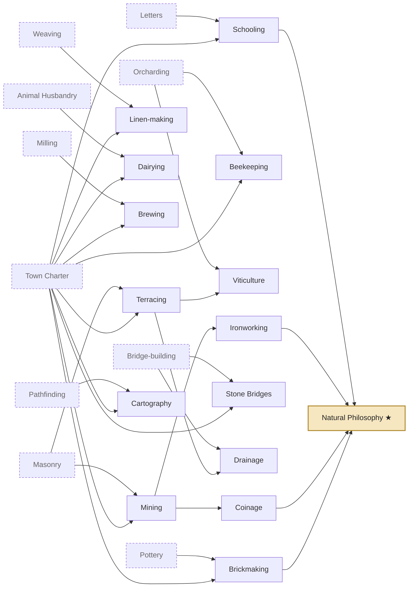
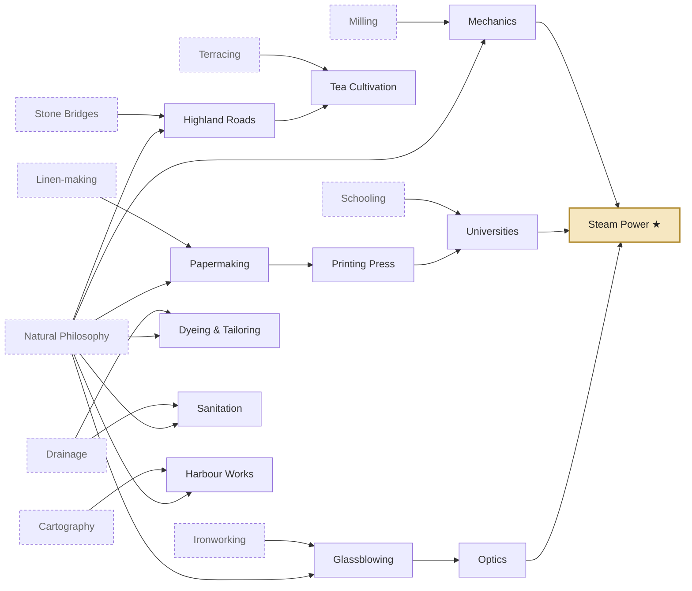
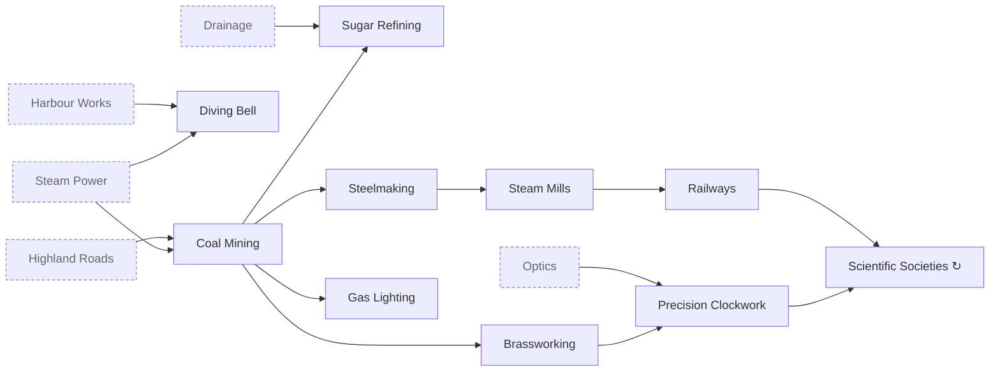

# Evenmere — Technology Tree

v0.2 · 18 Oct 2026 · Companion to the [progression ladders](progression.md) and the [culture tree](culture-tree.md).

50 technologies across four eras. Each one becomes `content/techs/<id>.json`, and its name and description go in `content/locale/en/techs.json`. Costs are in knowledge points and are starting proposals that the balance bot tunes.

## How research works

- **Knowledge** accrues once per day from Villagers, Townsfolk and Scholars, and from knowledge buildings: Founders' Hall / Town Hall, Scribe's Hall, Library, Observatory, Academy. See [knowledge sources](progression.md#knowledge-and-culture-sources).
- The player sets **one research target**, plus an optional queue. Overflow carries into the next target. Switching targets keeps the progress already made on each tech.
- **Inspirations:** each tech has a milestone condition. When it's met, before or during research, the tech's remaining cost drops by 40% of its full cost. A toast names the milestone, so play style is rewarded instead of waiting.
- **Era gating:** a tech of era N can be researched only once era N has begun. Era N+1 begins when the tech gateway ★ **and** the civic gateway of era N are both complete ([ADR-0010](../adr/0010-progression-gating.md)).
- **Effects** use the shared vocabulary in the [architecture plan](architecture.md#content-shapes-illustrative-the-schemas-are-authoritative): `unlockBuilding`, `unlockTier`, `unlockTerrainAccess`, `unlockFeature` and `modifier`.

| Era | Techs | Cost range | Total | Gateway into the next era |
| --- | --- | --- | --- | --- |
| I Founding | 13 | 30–160 | 800 | Town Charter ★ |
| II Township | 15 | 600–1,800 | 13,300 | Natural Philosophy ★ |
| III Enlightenment | 12 | 2,600–5,500 | 40,400 | Steam Power ★ |
| IV Industry | 10 | 6,000–12,000 | 80,000 + repeats | — |

## Era I — Founding

Known at the start (no research): Founders' Hall, Settler House, Dirt Road, Storehouse, Market, Woodcutter's Hut, Sawpit and Fishing Hut.

| Tech | id | Cost | Requires | Unlocks | Inspiration (−40%) |
| --- | --- | --- | --- | --- | --- |
| Animal Husbandry | `animal_husbandry` | 30 | — | Sheep Farm | Have 40 Settlers |
| Cultivation | `cultivation` | 30 | — | Grain Farm; fertility overlay | Have 8 houses |
| Stonecutting | `stonecutting` | 40 | — | Quarry; Cobbled Road | Stockpile 40 timber |
| Pathfinding | `pathfinding` | 30 | — | Scout's Lodge; expeditions | Lay 40 road tiles |
| Weaving | `weaving` | 50 | Animal Husbandry | Weaver's Cottage | Produce 20 wool |
| Milling | `milling` | 60 | Cultivation | Windmill; Bakery | Harvest 30 grain |
| Pottery | `pottery` | 50 | Cultivation | Clay Pit; Potter's Kiln | Store 30 fish |
| Orcharding | `orcharding` | 60 | Cultivation | Orchard; Cider Press | Have 4 Grain Farms |
| Net-weaving | `net_weaving` | 50 | Weaving | Fishing Huts +25% productivity | Have 5 Fishing Huts |
| Bridge-building | `bridge_building` | 70 | Pathfinding | Timber Bridge; access to narrow rivers | Complete 1 expedition |
| Letters | `letters` | 80 | Pottery | Scribe's Hall | Have 50 Villagers |
| Masonry | `masonry` | 90 | Stonecutting | Stone Storehouse; Plaza | Quarry 40 stone |
| **Town Charter ★** | `town_charter` | 160 | Milling, Weaving, Masonry, Letters | **Townsfolk tier**; Town Hall (upgrade of Founders' Hall); tech gateway to Era II | Have 150 Villagers |

## Era II — Township

Dashed nodes are prerequisites from Era I.

| Tech | id | Cost | Requires | Unlocks | Inspiration (−40%) |
| --- | --- | --- | --- | --- | --- |
| Brickmaking | `brickmaking` | 600 | Town Charter, Pottery | Brickworks | Produce 60 pottery |
| Mining | `mining` | 600 | Town Charter, Masonry | Iron Mine (hill iron deposits) | Discover an iron deposit |
| Ironworking | `ironworking` | 950 | Mining | Charcoal Kiln; Smelter; Toolsmith | Mine 30 iron ore |
| Linen-making | `linen_making` | 650 | Town Charter, Weaving | Flax Farm; Linen Weaver | Produce 100 homespun |
| Dairying | `dairying` | 650 | Town Charter, Animal Husbandry | Dairy Farm; Salt Works; Cheesemaker | Have 6 Sheep Farms |
| Brewing | `brewing` | 750 | Town Charter, Milling | Hop Garden; Brewery; Tavern | Produce 80 cider |
| Beekeeping | `beekeeping` | 650 | Town Charter, Orcharding | Apiary; Chandlery | Have 6 Orchards |
| Coinage | `coinage` | 900 | Mining | **Coin economy** (taxes, visitor spending, upkeep); Counting House | Have 100 Townsfolk |
| Schooling | `schooling` | 950 | Town Charter, Letters | School; Library | Have 3 Scribe's Halls |
| Terracing | `terracing` | 900 | Town Charter, Masonry | Farms may be placed on hills | Have 10 buildings on hills |
| Viticulture | `viticulture` | 1,050 | Terracing, Orcharding | Vineyard; Winery | Have 3 farms on hills |
| Stone Bridges | `stone_bridges` | 900 | Town Charter, Bridge-building | Stone Bridge; access to wide rivers | Build 3 Timber Bridges |
| Drainage | `drainage` | 1,200 | Terracing, Bridge-building | Drainage Ditch; marsh → fen | Reveal 3 marsh regions |
| Cartography | `cartography` | 750 | Town Charter, Pathfinding | Great Lighthouse (wonder); expeditions +50% speed; reveals the coastline | Complete 4 expeditions |
| **Natural Philosophy ★** | `natural_philosophy` | 1,800 | Schooling, Ironworking, Coinage, Brickmaking | Libraries +20% knowledge; tech gateway to Era III | Have 3 Libraries |

## Era III — Enlightenment

| Tech | id | Cost | Requires | Unlocks | Inspiration (−40%) |
| --- | --- | --- | --- | --- | --- |
| Papermaking | `papermaking` | 2,600 | Natural Philosophy, Linen-making | Paper Mill | Produce 200 linen |
| Printing Press | `printing_press` | 3,200 | Papermaking | Printing House | Display 3 Writing great works |
| Glassblowing | `glassblowing` | 2,800 | Natural Philosophy, Ironworking | Sand Pit; Glassworks | Produce 100 charcoal |
| Optics | `optics` | 3,500 | Glassblowing | Lens Grinder; Observatory | Produce 60 glass |
| Highland Roads | `highland_roads` | 2,800 | Natural Philosophy, Stone Bridges | Access to highlands (roads and buildings) | Reveal 2 highland regions |
| Tea Cultivation | `tea_cultivation` | 3,000 | Highland Roads, Terracing | Tea Garden | Have 10 farms on hills |
| Dyeing & Tailoring | `tailoring` | 3,200 | Natural Philosophy, Drainage | Madder Field; Tailor's Shop | Have 6 Linen Weavers |
| Mechanics | `mechanics` | 3,400 | Natural Philosophy, Milling | Water Mill; Windmills and Sawpits +20% productivity | Have 8 Windmills |
| Sanitation | `sanitation` | 3,200 | Natural Philosophy, Drainage | Bathhouse | Have 1,500 residents |
| Harbour Works | `harbour_works` | 3,000 | Natural Philosophy, Cartography | Harbour; Deep-water Fishery; access to deep water | Have 12 Fishing Huts |
| Universities | `universities` | 4,200 | Printing Press, Schooling | **Scholars tier**; Academy | Have 150 Artisans |
| **Steam Power ★** | `steam_power` | 5,500 | Mechanics, Universities, Optics | Tech gateway to Era IV | Have 100 Scholars |

## Era IV — Industry

| Tech | id | Cost | Requires | Unlocks | Inspiration (−40%) |
| --- | --- | --- | --- | --- | --- |
| Coal Mining | `coal_mining` | 6,000 | Steam Power, Highland Roads | Coal Mine | Produce 300 charcoal |
| Steelmaking | `steelmaking` | 7,000 | Coal Mining | Steelworks | Produce 200 iron |
| Brassworking | `brassworking` | 6,500 | Coal Mining | Copper Mine; Brass Foundry | Discover a copper deposit |
| Precision Clockwork | `precision_clockwork` | 8,500 | Brassworking, Optics | Clockmaker | Produce 100 spectacles |
| Diving Bell | `diving_bell` | 7,000 | Steam Power, Harbour Works | Access to reefs; Pearl Divers' Hut; Jeweller | Have 2 Harbours |
| Sugar Refining | `sugar_refining` | 7,000 | Coal Mining, Drainage | Beet Farm; Sugar Refinery; Confectioner | Produce 500 bread |
| Steam Mills | `steam_mills` | 8,000 | Steelmaking | Steam upgrade variants (+50% productivity, burn coal, −2 attractiveness) | Have 4 Steelworks |
| Railways | `railways` | 10,000 | Steam Mills | Rail Track; Railway Station; Railway Terminus (monument) | Have 400 road tiles |
| Gas Lighting | `gas_lighting` | 8,000 | Coal Mining | Gasworks; Gas Lamp | Have 6,000 residents |
| Scientific Societies ↻ | `scientific_societies` | 12,000, +10% per level | Railways, Precision Clockwork | +2% productivity island-wide per level (repeatable) | — |

## Ground opened by research

| Access flag | Tech | Era |
| --- | --- | --- |
| `narrow_rivers` | Bridge-building | I |
| `wide_rivers` | Stone Bridges | II |
| `hill_farming` | Terracing | II |
| `marsh_drainage` | Drainage | II |
| `highlands` | Highland Roads | III |
| `deep_water` | Harbour Works | III |
| `reefs` | Diving Bell | IV |

## Authoring notes

- A tech file lists every unlock in `effects`; buildings never name their tech (lint EVL005).
- The repeatable tech sets `"repeatable": { "costGrowthPercent": 10 }`.
- Inspiration conditions use the shared condition vocabulary, with the threshold inside the value object. For example: `{ "count": { "building": "fishing_hut", "atLeast": 5 } }`, `{ "population": { "tier": "villagers", "atLeast": 50 } }`, or `{ "stock": { "good": "timber", "atLeast": 40 } }` for the stockpile inspirations.
- Gateways set `"gateway": true`. Lint EVL008 checks that each era transition has exactly one tech gateway and one civic gateway.
