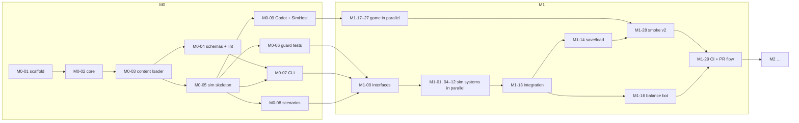

# Evenmere — Implementation Plan

v0.2 · 18 Oct 2026 · How Evenmere gets built, task by task, by coding agents under one orchestrator.

The work is split into six milestones. Each milestone has a file of **task cards**. A card is self-contained: an agent that reads [AGENTS.md](../../AGENTS.md), the card and the documents the card lists can do the task without other context.

| Milestone | File | Tasks | Gate (summary) |
| --- | --- | --- | --- |
| **M0 Foundations** | [M0-foundations.md](M0-foundations.md) | 9 | `verify.sh` green; deterministic hash over 10k ticks; Godot smoke |
| **M1 Vertical slice** | [M1-vertical-slice.md](M1-vertical-slice.md) | 31 | 100 Villagers with no stall (bot and playtester); **CI + PR flow live** |
| **M2 Era I complete** | [M2-era-one.md](M2-era-one.md) | 29 | Bot reaches Era II in 90–120 min on 5 seeds; budget at 2k residents |
| **M3 Era II, coin & culture depth** | [M3-era-two.md](M3-era-two.md) | 18 | Bot reaches Era III on 5 seeds; M2 saves migrate |
| **M4 Public build (macOS + Linux/Deck)** | [M4-public-build.md](M4-public-build.md) | 18 | Scale budget met; Deck checklist; notarised macOS build; playtest sign-off |
| **M5 Eras III–IV + Windows** | [M5-eras-three-four.md](M5-eras-three-four.md) | 14 | Full trees in 18–20 h for the bot; Windows build passes QA |

M0 and M1 are fully specified. From M2 onward, each milestone opens with a **kickoff task (Mx-00)**: a planning agent re-reads the code as it then exists and sharpens that milestone's cards before anything is dispatched.

## Lanes

Every task belongs to one lane. Lanes tell the orchestrator what tools an agent needs and where conflicts are likely.

| Lane | Works in | Needs |
| --- | --- | --- |
| `infra` | Solution files, scripts, CI | .NET SDK, git, GitHub access |
| `core` | `src/Evenmere.Core` | .NET SDK |
| `content-infra` | `src/Evenmere.Content`, `content/schemas` | .NET SDK |
| `content` | `content/**` (data only) | .NET SDK (to run lint) |
| `sim` | `src/Evenmere.Sim/**` and its tests | .NET SDK |
| `tools` | `src/Evenmere.Tools` | .NET SDK |
| `game` | `game/**` | .NET SDK, Godot 4.7 .NET |
| `human` | Playtests, accounts, art direction | The developer |

## Task card format

```markdown
### Mx-NN · Title
| Lane | Depends on | Owns |
| --- | --- | --- |
| sim | M1-00 | `src/Evenmere.Sim/Systems/Foo/**`, `tests/Evenmere.Sim.Tests/Foo/**` |

**Reads:** documents and sections to read first.
**Goal:** one or two sentences on the outcome.
**Steps:** a numbered, ordered list of what to build.
**Acceptance:** checkable statements, each proven by a command or test.
**Out of scope:** what not to do, even if tempting.
```

- **Depends on:** tasks that must be *merged* before this one starts.
- **Owns:** the only paths the agent may modify. Globs are relative to the repo root. "(section X only)" means the agent may edit only the named part of a shared file.
- **Acceptance** is the contract. If an item turns out to be impossible, the agent reports that rather than redefining it.

## Dispatch protocol (for the orchestrator)

The orchestrator is a Claude Code session, or the developer, working through one milestone at a time.

1. **Kick off the milestone.** Read its gate. For M2 and later, dispatch Mx-00 first and merge its refined cards.
2. **Pick ready tasks:** every dependency is merged and the task's status is `todo`.
3. **Avoid conflicts.** Never run two tasks at once whose **Owns** globs overlap. Lane-shared files (see below) are allowed only in the sections each card names.
4. **Dispatch** each ready task to a subagent in an **isolated worktree** on branch `task/<ID>-<slug>`. In Claude Code, use the Agent tool with `isolation: "worktree"`, using the prompt template below. Run independent tasks in parallel, up to about 4–6 at a time.
5. **Review the report against the card.** Check that every acceptance item has evidence, that the diff stays inside **Owns**, and that no test was weakened.
6. **Verify:** run `scripts/verify.sh` on the task branch. If it fails, send the failure back to the same agent (SendMessage) instead of starting a new one.
7. **Merge:**
   - Before M1-29: `git merge --no-ff task/<ID>-<slug>` into `main`, update the task's status to `done` in the milestone index in the same commit, then push.
   - From M1-29 onward: push the branch, open a PR titled `<ID>: <title>`, wait for green CI, and squash-merge.
8. **Handle blockers.** If an agent reports a blocker or an interface or ADR proposal, decide it, writing an ADR if a contract changes, then merge that decision before re-dispatching.
9. **Close the milestone.** When every task is done, run the gate checks, record the results in the milestone file's **Gate record**, and update the design docs and ADRs with what was learned.

### Status values

`todo` → `in progress` → `review` → `done`, plus `blocked` (with a one-line reason in the index table).

### Prompt template

```text
You are a coding agent on Evenmere, a calm island city builder (Godot 4.7 .NET + C#,
deterministic engine-free simulation).

Your task: {ID} — {Title}
Task card: docs/implementation/{milestone-file}.md, section "{ID} · {Title}"

Before you write code:
1. Read AGENTS.md: the hard rules, commands, definition of done and reporting format.
2. Read your task card in full, then every document listed under "Reads".
3. Look at the current code under your "Owns" paths and at the interfaces you depend on.

While you work:
- Modify only the paths listed under "Owns". If you need any other change, stop and report
  it as a blocker, with the exact change you need.
- Follow the steps in order. If a step is wrong or impossible, explain it in your report
  rather than inventing a different design.
- Run scripts/verify.sh before you finish; it must pass.

When you finish:
- Commit on your current branch with the message "{ID}: {Title}" and a body explaining
  what and why.
- Reply using the "Reporting back" format in AGENTS.md.
```

## Shared files and registration points

A few files are touched by many tasks. Each card names the section it may edit.

| File | Rule |
| --- | --- |
| `Evenmere.sln` | Only M0-01 creates it and M0-09 adds the game project. Later tasks never add projects without an ADR. |
| `Directory.Packages.props` | A card that names a new package adds one `PackageVersion` line. The orchestrator resolves conflicts. |
| `scripts/verify.sh` | Sections are marked `# --- section: <name> ---`. Cards name the section they may edit. |
| `src/Evenmere.Sim/Simulation/SystemPipeline.cs` | Written once in M0-05 with every system pre-registered in architecture order. Only an ADR changes the order. |
| `src/Evenmere.Sim/State/WorldState.cs` | M0-05 pre-declares one state slot per system. Tasks fill their own `Systems/<Name>/<Name>State.cs`. |
| `src/Evenmere.Sim/Queries/*.cs` | M0-05 creates the interfaces and M1-00 declares the cross-system methods. Afterwards, only an ADR or a card that explicitly names a method adds one. |
| `content/locale/en/*.json` | Each content task creates its own file. Never edit another task's locale file. |
| `game/data/visuals/*.json` | One file per content area (`era1-production.json`, …), owned by the task that adds those visuals. |

## Milestone overview and critical path



## Human tasks and decisions owed by the developer

| When | What |
| --- | --- |
| Before M0 | Install the .NET 10 SDK and Godot 4.7 .NET on the development Mac. |
| M1-29 | Enable branch protection on `main` (required status checks, PRs required), or grant the agent permission to do it. |
| M1-30, M2, M3 gates | Playtest the build and sign off on calmness and pacing. |
| Before M4-09 | Provide an Apple Developer ID certificate and notarisation credentials as CI secrets. |
| Before M4-11 | Provide a Steamworks partner account and app ID. |
| M4-14 | Decide the art source: own Blender work, asset packs or commissioned. |
| M4 | Decide the visual day/night cycle and the audio sourcing (see the open items in the architecture plan). |
